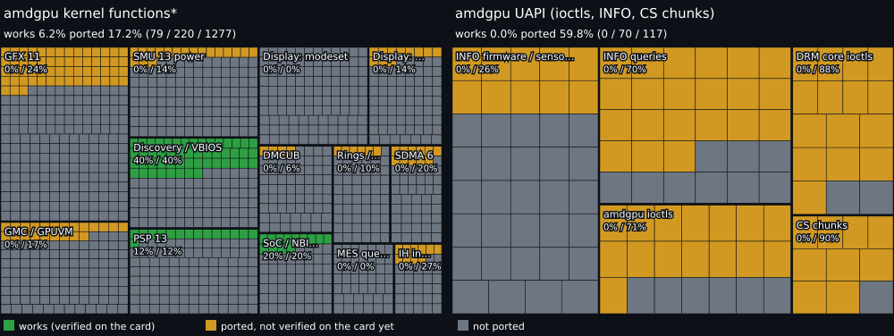

# RDNA3-Hackintosh

An open-source macOS driver (x86_64, Hackintosh) for AMD RDNA3 cards,
starting with the **Radeon RX 7800 XT (Navi 32, PCI `1002:747E`)**.

> **Status:** the code for stages 1, 2 (PSP/firmware/SMU), 4, 5 and 6 is written and
> builds in CI, but **nothing has run on a real card yet**.
> The driver does not display or accelerate anything. Status of each stage:
> [docs/ROADMAP.md](docs/ROADMAP.md).

## Status

[](docs/status/STATUS.md) [](docs/status/STATUS.md)

[](docs/status/STATUS.md)

<sub>🟩 works: ported and verified on the card · 🟨 ported, checked only in the simulator and CI · ⬜ not ported.
"Ported" includes "works" (e.g. 30% works + 20% unverified = 50% ported).
\* amdgpu kernel functions: percentage of the functions in the amdgpu source files the project ports from
(listed in [tools/progress/sources.txt](tools/progress/sources.txt), Linux v6.12), not of all of amdgpu;
the total grows as files are added. Both measures leave out what does not apply - not on the RX 7800 XT,
or of no use on macOS - with the reason for each
([tools/progress/not-applicable.txt](tools/progress/not-applicable.txt)). A block turns green when the ladder steps that exercise it passed on
the card ([docs/status/hw-verified.txt](docs/status/hw-verified.txt)). Per-function lists:
[docs/status/STATUS.md](docs/status/STATUS.md).</sub>

## What is in the repo

| Path | What it is |
|---|---|
| `kext/` | `RDNA3Accel.kext`: PCI matching, BAR5 (MMIO) mapping, safe reads, reading and decoding the IP discovery table from VRAM |
| `common/amd_discovery.[ch]` | Portable parser for the *IP discovery* table (C99, no libc, checks all bounds). The same code runs in the kext and on the host |
| `tests/` | Parser unit tests and mutation fuzzing under ASan/UBSan |
| `tools/amd_discovery_dump.c` | Host-side discovery blob decoder: IP versions, register bases, required firmware files |
| `tools/linux/` | Dump of reference data from the same card under Linux/amdgpu |
| `tools/macos/` | Extracts the discovery blob published by the kext from `ioreg` |
| `hw/` | Portable bring-up (PSP 13.0.x, SMU 13.0.x, registers, VRAM), tested on the `tests/sim_navi32.c` simulator |
| `uapi/` | OS-independent Linux amdgpu UAPI (used by the kext and the tests) |
| `userspace/` | `libdrm_xnu` (libdrm core over IOKit) + libdrm_amdgpu build; `mesa/` = RADV build on macOS and patches |
| `metal/` | Metal plugin and AIR→SPIR-V translator from NullMoth, adapted to AMD |
| `package/` | Installer: `.pkg`/tarball (`make_pkg.sh`), firmware download, OpenCore helper and snippet, uninstall |
| `third_party/` | AMD/DRM headers (MIT) and libdrm_amdgpu (MIT) |
| `docs/` | Plan, test bench setup, test instructions, firmware licenses, [analysis of the NullMoth driver (NVIDIA)](docs/NULLMOTH-ANALYSIS.md) |

## Quick start

On any system (Linux/macOS):

```sh
make test     # parser tests + fuzzing (ASan/UBSan)
make tools    # build/host/amd_discovery_dump
```

On a Mac with Xcode (the kext is built only there):

```sh
make kext     # -> build/RDNA3Accel.kext (x86_64)
```

CI (GitHub Actions, self-hosted macOS runner) builds the kext and attaches it as an artifact.

**Test on Linux with this card as the only one (macOS in a VM, passthrough):**
[docs/TESTING-VM.md](docs/TESTING-VM.md), i.e. a single script `tools/vm/rdna3vm`, step by step.
Test on a hackintosh: [docs/TESTING-HW.md](docs/TESTING-HW.md).
What to do with the test reports: [docs/AFTER-TESTS.md](docs/AFTER-TESTS.md).

Loading the kext on the test machine and the safety levels (`rdna3lvl=`)
are described in [docs/STAGE1.md](docs/STAGE1.md). Read
[docs/STAGE0.md](docs/STAGE0.md) first: **do not test without a second card for display.**

## Install

On a bare-metal Hackintosh (macOS 15, OpenCore): the installer package
(CI artifact `RDNA3-pkg`, or `package/make_pkg.sh` on a Mac) puts the kexts in
`/Library/Extensions` and downloads the AMD firmware from linux-firmware; no
boot-args are needed (default profile). OpenCore settings, opt-in boot-args and
the way back: [docs/INSTALL-OPENCORE.md](docs/INSTALL-OPENCORE.md). Testing
and reports without the VM:
[docs/TESTING-HW.md](docs/TESTING-HW.md#bare-metal-with-the-installer-no-vm-harness).

## Project rules

* **amdgpu (Linux) is the source of truth** for the hardware. Every register in the code has
  a reference to the amdgpu header file it comes from. amdgpu is
  MIT-licensed, so the port is license-compatible.
* **Read-only first.** Each stage adds writes to the hardware only once
  the reads match the Linux reference (`tools/linux/`).
* **Data from the hardware is untrusted.** Parsers check bounds and are fuzzed;
  a bad blob must not crash the kernel.
* **AMD firmware does not go into the repo.** See [docs/FIRMWARE.md](docs/FIRMWARE.md).

## License

MIT, see [LICENSE](LICENSE). AMD firmware has its own license (`LICENSE.amdgpu`
from linux-firmware) and is not distributed here.
