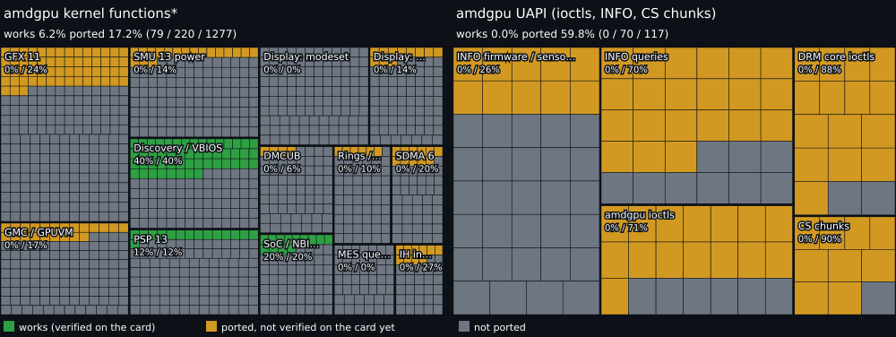

# Porting status

Generated by `tools/progress.py` (do not edit). Steps passed on the card: 0, 1, 10, 10a, 10m, 11, 11r, 2, 3, 4, 5, 5b, 6, 6b, 7, 8, 8c, 8g, 8h, 8i, 8m, 8o, 8s, 8u, 8v, 8w, 9, 9b, 9c, 9d, 9m, 9s, hanggfx, hotplug, modeset, modeset2 (`docs/status/hw-verified.txt`).

## amdgpu kernel functions

236 items that do not apply (not on the RX 7800 XT, or of no use on macOS) are left out of the totals; each group lists them with the reason (`tools/progress/not-applicable.txt`).

| Block | Works | Ported | Total | Works % | Ported % | Verified by step |
|---|---:|---:|---:|---:|---:|---|
| Discovery / VBIOS | 66 | 66 | 111 | 59% | 59% | 2 |
| Display: color | 0 | 12 | 25 | 0% | 48% | gamma |
| Display: DP link | 0 | 86 | 160 | 0% | 54% | dplink |
| Display: hotplug | 7 | 7 | 12 | 58% | 58% | hotplug |
| Display: modeset | 35 | 57 | 189 | 19% | 30% | modeset |
| Display: OTG / AUX | 25 | 25 | 71 | 35% | 35% | 2, 9 |
| DMCUB | 26 | 26 | 65 | 40% | 40% | 5b |
| GFX 11 | 93 | 98 | 205 | 45% | 48% | 8 |
| GMC / GPUVM | 56 | 56 | 117 | 48% | 48% | 6, 7 |
| IH interrupts | 13 | 13 | 33 | 39% | 39% | 6, 6b |
| MES queues | 0 | 19 | 45 | 0% | 42% | mes |
| PSP 13 | 46 | 74 | 95 | 48% | 78% | 4 |
| Rings / fences | 11 | 16 | 45 | 24% | 36% | 7, 8 |
| SDMA 6 | 16 | 17 | 49 | 33% | 35% | 7 |
| SMU 13 power | 33 | 82 | 129 | 26% | 64% | 5 |
| SoC / NBIO / HDP | 28 | 31 | 60 | 47% | 52% | 1, 4 |
| User queues | 0 | 43 | 46 | 0% | 93% | userq |
| VCN / JPEG video | 0 | 85 | 94 | 0% | 90% | vcn |
| **Total** | 455 | 813 | 1551 | 29.3% | 52.4% | |

Discovery / VBIOS: 66 ported, 45 to do, 16 do not apply

Ported: `amdgpu_atom_execute_table`, `amdgpu_atom_execute_table_locked`, `amdgpu_atom_parse`, `amdgpu_atom_parse_cmd_header`, `amdgpu_atom_parse_data_header`, `amdgpu_atomfirmware_asic_init`, `amdgpu_atomfirmware_get_fw_reserved_fb_size`, `amdgpu_atomfirmware_query_firmware_capability`, `amdgpu_atomfirmware_scratch_regs_init`, `amdgpu_discovery_calculate_checksum`, `amdgpu_discovery_get_gfx_info`, `amdgpu_discovery_reg_base_init`, `amdgpu_discovery_verify_binary_signature`, `amdgpu_discovery_verify_checksum`, `amdgpu_ucode_create_bo`, `amdgpu_ucode_init_bo`, `amdgpu_ucode_init_single_fw`, `atom_find_str_in_rom`, `atom_get_dst`, `atom_get_src`, `atom_get_src_direct`, `atom_get_src_int`, `atom_get_vbios_date`, `atom_get_vbios_name`, `atom_get_vbios_pn`, `atom_get_vbios_version`, `atom_iio_execute`, `atom_index_iio`, `atom_op_add`, `atom_op_and`, `atom_op_beep`, `atom_op_calltable`, `atom_op_clear`, `atom_op_compare`, `atom_op_debug`, `atom_op_delay`, `atom_op_div`, `atom_op_div32`, `atom_op_eot`, `atom_op_jump`, `atom_op_mask`, `atom_op_move`, `atom_op_mul`, `atom_op_mul32`, `atom_op_nop`, `atom_op_or`, `atom_op_postcard`, `atom_op_processds`, `atom_op_repeat`, `atom_op_restorereg`, `atom_op_savereg`, `atom_op_setdatablock`, `atom_op_setfbbase`, `atom_op_setport`, `atom_op_setregblock`, `atom_op_shift_left`, `atom_op_shift_right`, `atom_op_shl`, `atom_op_shr`, `atom_op_sub`, `atom_op_switch`, `atom_op_test`, `atom_op_xor`, `atom_put_dst`, `atom_skip_dst`, `atom_skip_src_int`

To do: `amdgpu_atom_asic_init`, `amdgpu_atom_destroy`, `amdgpu_atomfirmware_allocate_fb_scratch`, `amdgpu_atomfirmware_allocate_fb_v2_1`, `amdgpu_atomfirmware_allocate_fb_v2_2`, `amdgpu_atomfirmware_dynamic_boot_config_supported`, `amdgpu_atomfirmware_get_clock_info`, `amdgpu_atomfirmware_get_gfx_info`, `amdgpu_atomfirmware_get_vram_info`, `amdgpu_atomfirmware_mem_training_supported`, `amdgpu_discovery_fini`, `amdgpu_discovery_get_harvest_info`, `amdgpu_discovery_get_mall_info`, `amdgpu_discovery_get_vcn_info`, `amdgpu_discovery_harvest_config_quirk`, `amdgpu_discovery_harvest_ip`, `amdgpu_discovery_init`, `amdgpu_discovery_init_soc_config`, `amdgpu_discovery_read_binary_from_mem`, `amdgpu_discovery_read_from_harvest_table`, `amdgpu_discovery_read_harvest_bit_per_ip`, `amdgpu_discovery_set_common_ip_blocks`, `amdgpu_discovery_set_display_ip_blocks`, `amdgpu_discovery_set_gc_ip_blocks`, `amdgpu_discovery_set_gmc_ip_blocks`, `amdgpu_discovery_set_ih_ip_blocks`, `amdgpu_discovery_set_ip_blocks`, `amdgpu_discovery_set_mes_ip_blocks`, `amdgpu_discovery_set_mm_ip_blocks`, `amdgpu_discovery_set_psp_ip_blocks`, `amdgpu_discovery_set_sdma_ip_blocks`, `amdgpu_discovery_set_smu_ip_blocks`, `amdgpu_discovery_validate_ip`, `amdgpu_ucode_free_bo`, `amdgpu_ucode_get_load_type`, `amdgpu_ucode_hdr_version`, `amdgpu_ucode_ip_version_decode`, `amdgpu_ucode_is_valid`, `amdgpu_ucode_legacy_naming`, `amdgpu_ucode_name`, `amdgpu_ucode_patch_jt`, `amdgpu_ucode_release`, `amdgpu_ucode_request`, `amdgpu_ucode_validate`, `convert_atom_mem_type_to_vram_type`

Not counted (does not apply):

- SR-IOV virtual functions (Linux host virtualization): `amdgpu_atomfirmware_gpu_virtualization_supported`
- ECC / RAS: the card's GDDR6 has no ECC: `amdgpu_atomfirmware_mem_ecc_supported`, `amdgpu_atomfirmware_sram_ecc_supported`
- memory partitions (NPS): Instinct (MI300) only: `amdgpu_discovery_get_nps_info`, `amdgpu_discovery_verify_npsinfo`
- discovery table from a file (Linux module option): `amdgpu_discovery_read_binary_from_file`
- discovery table from ACPI system memory: APUs: `amdgpu_discovery_read_binary_from_sysmem`
- ISP, VPE, UMSCH: APU blocks, not on Navi 32: `amdgpu_discovery_set_isp_ip_blocks`, `amdgpu_discovery_set_umsch_mm_ip_blocks`, `amdgpu_discovery_set_vpe_ip_blocks`
- Linux kobject / sysfs: `amdgpu_ucode_sys_visible`, `die_kobj_release`, `ip_die_entry_release`, `ip_disc_release`, `ip_hw_id_release`, `ip_hw_instance_release`

Display: color: 12 ported, 13 to do, 23 do not apply

Ported: `cm3_helper_convert_to_custom_float`, `cm3_helper_translate_curve_to_hw_format`, `cm_helper_program_gamcor_xfer_func`, `is_rgb_equal`, `mpc3_configure_ogam_lut`, `mpc3_get_ogam_current`, `mpc3_ogam_get_reg_field`, `mpc3_power_on_ogam_lut`, `mpc3_program_luta`, `mpc3_program_lutb`, `mpc3_program_ogam_pwl`, `mpc3_set_output_gamma`

To do: `cm3_helper_translate_curve_to_degamma_hw_format`, `mpc3_get_gamut_remap`, `mpc3_init_mpcc`, `mpc3_mpc_init`, `mpc3_mpc_init_single_inst`, `mpc3_set_denorm`, `mpc3_set_denorm_clamp`, `mpc3_set_gamut_remap`, `mpc3_set_mpc_mem_lp_mode`, `mpc3_set_ocsc_default`, `mpc3_set_output_csc`, `program_gamut_remap`, `read_gamut_remap`

Not counted (does not apply):

- Linux Display Core object constructors / destructors: `dcn30_mpc_construct`
- DCN 3.0 code path: DCN 3.2 uses its own mpc32_* / mpc1_* (dcn32_mpc_funcs): `get3dlut_config`, `mpc3_configure_shaper_lut`, `mpc3_get_rmu_mux_status`, `mpc3_get_shaper_current`, `mpc3_power_on_shaper_3dlut`, `mpc3_program_3dlut`, `mpc3_program_shaper`, `mpc3_program_shaper_lut`, `mpc3_program_shaper_luta_settings`, `mpc3_program_shaper_lutb_settings`, `mpc3_read_mpcc_state`, `mpc3_select_3dlut_ram`, `mpc3_select_3dlut_ram_mask`, `mpc3_set3dlut_ram10`, `mpc3_set3dlut_ram12`, `mpc3_set_3dlut_mode`, `mpc3_set_rmu_mux`, `mpcc3_acquire_rmu`, `mpcc3_release_rmu`
- display writeback: macOS does not use it: `mpc3_disable_dwb_mux`, `mpc3_is_dwb_idle`, `mpc3_set_dwb_mux`

Display: DP link: 86 ported, 74 to do, 8 do not apply

Ported: `configure_lttpr_mode_transparent`, `decide_8b_10b_training_settings`, `decide_cr_training_pattern`, `decide_dp_link_settings`, `decide_eq_training_pattern`, `decide_fallback_link_setting`, `disable_dio_link_output`, `dp_check_interlane_aligned`, `dp_check_link_loss_status`, `dp_decide_8b_10b_lttpr_mode`, `dp_decide_lane_settings`, `dp_decide_training_settings`, `dp_disable_link_phy`, `dp_enable_link_phy`, `dp_get_cr_failure`, `dp_get_eq_aux_rd_interval`, `dp_get_lane_status_and_lane_adjust`, `dp_get_max_link_cap`, `dp_get_nibble_at_index`, `dp_get_verified_link_cap`, `dp_hw_to_dpcd_lane_settings`, `dp_initialize_scrambling_data_symbols`, `dp_is_ch_eq_done`, `dp_is_cr_done`, `dp_is_interlane_aligned`, `dp_is_lttpr_present`, `dp_is_max_vs_reached`, `dp_is_symbol_locked`, `dp_link_bandwidth_kbps`, `dp_log_training_result`, `dp_parse_lttpr_repeater_count`, `dp_perform_8b_10b_link_training`, `dp_perform_link_training`, `dp_retrieve_lttpr_cap`, `dp_set_drive_settings`, `dp_set_hw_lane_settings`, `dp_set_hw_test_pattern`, `dp_set_hw_training_pattern`, `dp_transition_to_video_idle`, `dp_translate_training_aux_read_interval`, `dp_validate_mode_timing`, `dp_verify_link_cap`, `dp_verify_link_cap_with_retries`, `dp_wait_for_training_aux_rd_interval`, `dpcd_configure_channel_coding`, `dpcd_configure_lttpr_mode`, `dpcd_exit_training_mode`, `dpcd_set_lane_settings`, `dpcd_set_link_settings`, `dpcd_set_lt_pattern_and_lane_settings`, `dpcd_set_training_pattern`, `dpcd_write_rx_power_ctrl`, `enable_dio_dp_link_output`, `enc1_dig_connect_to_otg`, `enc1_dig_source_otg`, `enc1_stream_encoder_dp_blank`, `enc1_stream_encoder_dp_set_stream_attribute`, `enc1_stream_encoder_hdmi_set_stream_attribute`, `get_cr_training_aux_rd_interval`, `get_dpcd_link_rate`, `get_eq_training_aux_rd_interval`, `get_link_rate_from_max_link_bw`, `get_lttpr_max_link_rate`, `get_max_pre_emphasis_for_voltage_swing`, `increase_lane_count`, `increase_link_rate`, `link_decide_link_settings`, `link_dp_get_encoding_format`, `maximize_lane_settings`, `override_lane_settings`, `override_training_settings`, `perform_8b_10b_channel_equalization_sequence`, `perform_8b_10b_clock_recovery_sequence`, `perform_link_training_with_retries`, `perform_post_lt_adj_req_sequence`, `reached_minimum_lane_count`, `reached_minimum_link_rate`, `reduce_lane_count`, `reduce_link_rate`, `reset_dio_stream_encoder`, `retrieve_link_cap`, `set_dio_dp_lane_settings`, `set_dio_dp_link_test_pattern`, `setup_dio_stream_attribute`, `setup_dio_stream_encoder`, `wake_up_aux_channel`

To do: `can_use_dio_link_hwss`, `configure_lttpr_mode_non_transparent`, `decide_fallback_link_setting_max_bw_policy`, `decide_mst_link_settings`, `detect_dp_sink_caps`, `disable_dio_audio_packet`, `dp_active_dongle_validate_timing`, `dp_check_dpcd_reqeust_status`, `dp_decide_lttpr_mode`, `dp_get_lttpr_mode_override`, `dp_get_max_link_enc_cap`, `dp_is_128b_132b_signal`, `dp_is_fec_supported`, `dp_is_sink_present`, `dp_overwrite_extended_receiver_cap`, `dp_set_fec_enable`, `dp_set_fec_ready`, `dp_should_enable_fec`, `dpcd_read_sink_ext_caps`, `dpcd_set_source_specific_data`, `dpcd_write_cable_id_to_dprx`, `enable_dio_audio_packet`, `enc1_reset_hdmi_stream_attribute`, `enc1_se_audio_mute_control`, `enc1_se_audio_setup`, `enc1_se_disable_dp_audio`, `enc1_se_dp_audio_disable`, `enc1_se_dp_audio_enable`, `enc1_se_dp_audio_setup`, `enc1_se_enable_audio_clock`, `enc1_se_enable_dp_audio`, `enc1_se_hdmi_audio_disable`, `enc1_se_hdmi_audio_setup`, `enc1_se_setup_dp_audio`, `enc1_se_setup_hdmi_audio`, `enc1_setup_stereo_sync`, `enc1_stream_encoder_dp_get_pixel_format`, `enc1_stream_encoder_dp_unblank`, `enc1_stream_encoder_dvi_set_stream_attribute`, `enc1_stream_encoder_send_immediate_sdp_message`, `enc1_stream_encoder_set_avmute`, `enc1_stream_encoder_set_stream_attribute_helper`, `enc1_stream_encoder_set_throttled_vcp_size`, `enc1_stream_encoder_stop_dp_info_packets`, `enc1_stream_encoder_stop_hdmi_info_packets`, `enc1_stream_encoder_update_dp_info_packets`, `enc1_stream_encoder_update_hdmi_info_packets`, `enc1_update_generic_info_packet`, `enc1_update_hdmi_info_packet`, `get_active_converter_info`, `get_audio_clock_info`, `get_cable_max_link_rate`, `get_clock_source_id`, `get_dio_link_hwss`, `get_tmds_output_pixel_clock_100hz`, `intersect_cable_id`, `intersect_frl_link_bw_support`, `is_dp_active_dongle`, `is_dp_branch_device`, `is_immediate_downstream`, `is_repeater`, `link_bw_kbps_from_raw_frl_link_rate_data`, `link_validate_mode_timing`, `mst_decide_link_encoding_format`, `read_dp_device_vendor_id`, `read_is_mst_supported`, `repeater_training_done`, `retrieve_cable_id`, `set_dio_throttled_vcp_size`, `setup_dio_audio_output`, `speakers_to_channels`, `start_clock_recovery_pattern_early`, `translate_dpcd_max_bpc`, `update_dio_stream_allocation_table`

Not counted (does not apply):

- USB-C combo PHY / DP tunnelling (DPIA): the card has no USB-C port: `apply_usbc_combo_phy_reset_wa`, `get_usbc_cable_id`, `link_validate_dpia_bandwidth`
- Linux Display Core object constructors / destructors: `dcn10_stream_encoder_construct`
- eDP link rate sets (ILR): a desktop card has no built-in panel: `decide_edp_link_settings_with_dsc`, `detect_edp_sink_caps`, `edp_decide_link_settings`, `increase_edp_link_rate`

Display: hotplug: 7 ported, 5 to do, 3 do not apply

Ported: `get_value`, `link_enable_hpd`, `link_enable_hpd_filter`, `link_get_hpd_state`, `program_hpd_filter`, `query_hpd_status`, `set_config`

To do: `dal_hw_hpd_get_pin`, `dal_hw_hpd_init`, `get_hpd_line`, `link_disable_hpd`, `link_get_hpd_gpio`

Not counted (does not apply):

- Linux Display Core object constructors / destructors: `dal_hw_hpd_construct`, `dal_hw_hpd_destroy`, `dal_hw_hpd_destruct`

Display: modeset: 57 ported, 132 to do, 26 do not apply

Ported: `dccg32_get_pixel_rate_div`, `dccg32_set_pixel_rate_div`, `dcn10_aux_initialize`, `dcn10_get_dig_frontend`, `dcn10_get_dig_mode`, `dcn10_is_dig_enabled`, `dcn10_link_encoder_connect_dig_be_to_fe`, `dcn10_link_encoder_disable_output`, `dcn10_link_encoder_dp_set_lane_settings`, `dcn10_link_encoder_dp_set_phy_pattern`, `dcn10_link_encoder_enable_dp_output`, `dcn10_link_encoder_enable_hpd`, `dcn10_link_encoder_enable_tmds_output`, `dcn10_link_encoder_get_max_link_cap`, `dcn10_link_encoder_hw_init`, `dcn10_link_encoder_set_dp_phy_pattern_training_pattern`, `dcn10_link_encoder_setup`, `dcn32_clk_mgr_construct`, `dcn32_disable_link_output`, `dcn32_get_hard_min_status_supported`, `dcn32_get_vco_frequency_from_reg`, `dcn32_hubp_pg_control`, `dcn32_init_clocks`, `dcn32_init_hw`, `dcn32_init_single_clock`, `dcn32_set_output_transfer_func`, `dcn32_smu_send_msg_with_param`, `dcn32_smu_set_hard_min_by_freq`, `dcn32_smu_wait_for_dmub_ack_mclk`, `dcn32_smu_wait_for_response`, `dcn32_smu_wait_get_hard_min_status`, `dcn32_unblank_stream`, `dcn32_update_clocks`, `dcn32_update_clocks_update_dentist`, `dcn32_update_clocks_update_dpp_dto`, `dcn32_update_dppclk_dispclk_freq`, `disable_link`, `disable_link_dp`, `disable_prbs_mode`, `enable_link_dp`, `enable_link_hdmi`, `enable_phy_bypass_mode`, `enc1_configure_encoder`, `enc32_dp_set_odm_combine`, `enc32_enable_fifo`, `enc32_reset_fifo`, `enc32_set_dig_input_mode`, `enc32_stream_encoder_dp_unblank`, `hubbub3_force_pstate_change_control`, `hubbub3_init_dchub_sys_ctx`, `link_encoder_disable`, `link_set_dpms_off`, `link_set_dpms_on`, `link_transmitter_control`, `set_dp_phy_pattern_passthrough_mode`, `set_link_training_complete`, `setup_panel_mode`

To do: `allocate_mst_payload`, `apply_symclk_on_tx_off_wa`, `convert_and_clamp`, `dccg32_get_dccg_ref_freq`, `dccg32_otg_add_pixel`, `dccg32_otg_drop_pixel`, `dccg32_set_dpstreamclk`, `dccg32_set_dtbclk_dto`, `dccg32_set_dtbclk_p_src`, `dccg32_set_valid_pixel_rate`, `dccg32_trigger_dio_fifo_resync`, `dcn10_link_encoder_disable_hpd`, `dcn10_link_encoder_enable_dp_mst_output`, `dcn10_link_encoder_enable_tmds_output_with_clk_pattern_wa`, `dcn10_link_encoder_update_mst_stream_allocation_table`, `dcn10_link_encoder_validate_dp_output`, `dcn10_link_encoder_validate_dvi_output`, `dcn10_link_encoder_validate_hdmi_output`, `dcn10_link_encoder_validate_output_with_stream`, `dcn32_apply_idle_power_optimizations`, `dcn32_apply_update_flags_for_phantom`, `dcn32_are_clock_states_equal`, `dcn32_blank_phantom`, `dcn32_build_wm_range_table`, `dcn32_calculate_cab_allocation`, `dcn32_calculate_dccg_k1_k2_values`, `dcn32_calculate_pix_rate_divider`, `dcn32_check_native_scaling`, `dcn32_check_no_memory_request_for_cab`, `dcn32_clock_read_ss_info`, `dcn32_commit_subvp_config`, `dcn32_disable_phantom_streams`, `dcn32_dsc_pg_control`, `dcn32_dsc_pg_status`, `dcn32_enable_phantom_streams`, `dcn32_enable_pme_wa`, `dcn32_enable_power_gating_plane`, `dcn32_get_dispclk_from_dentist`, `dcn32_get_memclk_states_from_smu`, `dcn32_init_blank`, `dcn32_initialize_min_clocks`, `dcn32_interdependent_update_lock`, `dcn32_is_dp_dig_pixel_rate_div_policy`, `dcn32_is_pipe_topology_transition_seamless`, `dcn32_is_smu_present`, `dcn32_notify_wm_ranges`, `dcn32_prepare_bandwidth`, `dcn32_program_mall_pipe_config`, `dcn32_program_outstanding_updates`, `dcn32_resync_fifo_dccg_dio`, `dcn32_set_hard_max_memclk`, `dcn32_set_hard_min_memclk`, `dcn32_set_input_transfer_func`, `dcn32_set_max_memclk`, `dcn32_set_mcm_luts`, `dcn32_set_min_memclk`, `dcn32_set_mpc_shaper_3dlut`, `dcn32_smu_get_hard_min_status`, `dcn32_smu_send_cab_for_uclk_message`, `dcn32_smu_send_fclk_pstate_message`, `dcn32_smu_send_msg_with_param_delay`, `dcn32_smu_set_pme_workaround`, `dcn32_smu_transfer_wm_table_dram_2_smu`, `dcn32_smu_wait_for_response_delay`, `dcn32_subvp_pipe_control_lock`, `dcn32_subvp_pipe_control_lock_fast`, `dcn32_update_clocks_update_dtb_dto`, `dcn32_update_dsc_on_stream`, `dcn32_update_dsc_pg`, `dcn32_update_force_pstate`, `dcn32_update_mall_sel`, `dcn32_update_odm`, `dcn32_update_phantom_vp_position`, `deallocate_mst_payload`, `dp_set_dsc_on_rx`, `enable_link`, `enable_link_dp_mst`, `enable_mst_on_sink`, `enable_stream_features`, `enc32_dp_set_dsc_config`, `enc32_read_state`, `enc32_stream_encoder_dvi_set_stream_attribute`, `enc32_stream_encoder_hdmi_set_stream_attribute`, `fill_stream_allocation_row_info`, `get_ext_hdmi_settings`, `get_frontend_source`, `get_lane_status`, `get_odm_config`, `get_pbn_from_bw_in_kbps`, `get_pbn_from_timing`, `get_pbn_per_slot`, `hpd_initialize`, `hubbub3_dcc_support_swizzle`, `hubbub3_det_request_size`, `hubbub3_force_wm_propagate_to_pipes`, `hubbub3_get_blk256_size`, `hubbub3_get_dcc_compression_cap`, `hubbub3_init_watermarks`, `hubbub3_program_watermarks`, `hubp32_cursor_set_attributes`, `hubp32_init`, `hubp32_phantom_hubp_post_enable`, `hubp32_prepare_subvp_buffering`, `hubp32_update_force_cursor_pstate_disallow`, `hubp32_update_force_pstate_disallow`, `hubp32_update_mall_sel`, `is_master_pipe_for_link`, `is_subvp_phantom_topology_transition_seamless`, `is_two_pixels_per_containter`, `link_blank_all_dp_displays`, `link_blank_dp_stream`, `link_calculate_sst_avg_time_slots_per_mtp`, `link_get_master_pipes_with_dpms_on`, `link_increase_mst_payload`, `link_reduce_mst_payload`, `link_resume`, `link_set_all_streams_dpms_off_for_link`, `link_set_dsc_enable`, `link_set_dsc_on_stream`, `link_set_dsc_pps_packet`, `link_update_dsc_config`, `poll_for_allocation_change_trigger`, `remove_stream_from_alloc_table`, `set_avmute`, `update_mst_stream_alloc_table`, `update_psp_stream_config`, `update_sst_payload`, `write_128b_132b_sst_payload_allocation_table`, `write_i2c`, `write_i2c_default_retimer_setting`, `write_i2c_redriver_setting`, `write_i2c_retimer_setting`

Not counted (does not apply):

- USB4 bandwidth allocation: the card has no USB-C / USB4 port: `allocate_usb4_bandwidth`, `allocate_usb4_bandwidth_for_stream`, `deallocate_usb4_bandwidth`
- Linux Display Core object constructors / destructors: `dccg32_create`, `dcn10_link_encoder_construct`, `dcn10_link_encoder_destroy`, `dcn32_clk_mgr_destroy`, `dcn32_dio_stream_encoder_construct`, `hubbub3_construct`, `hubp32_construct`
- eDP / LVDS panels and PSR: a desktop card has no built-in panel: `dcn10_psr_program_dp_dphy_fast_training`, `dcn10_psr_program_secondary_packet`, `enable_link_edp`, `enable_link_lvds`, `link_blank_all_edp_displays`
- debug logging: `dcn32_auto_dpm_test_log`, `dsc_optc_config_log`, `log_vcp_x_y`
- DisplayPort compliance test patterns (certification equipment): `disable_prbs_symbols`, `program_pattern_symbols`, `set_dp_phy_pattern_80bit_custom`, `set_dp_phy_pattern_d102`, `set_dp_phy_pattern_hbr2_compliance_cp2520_2`, `set_dp_phy_pattern_prbs7`, `set_dp_phy_pattern_symbol_error`
- Linux virtual display connector: `enable_link_virtual`

Display: OTG / AUX: 25 ported, 46 to do, 8 do not apply

Ported: `acquire`, `acquire_engine`, `apply_front_porch_workaround`, `dce_aux_transfer_raw`, `dce_aux_transfer_with_retries`, `get_channel_status`, `is_engine_available`, `optc1_configure_crc`, `optc1_disable_crtc`, `optc1_get_crc`, `optc1_get_hw_timing`, `optc1_get_vblank_counter`, `optc1_is_tg_enabled`, `optc1_program_global_sync`, `optc1_program_timing`, `optc1_read_otg_state`, `optc1_set_vtg_params`, `optc1_set_vtotal_min_max`, `optc1_unlock`, `optc32_disable_crtc`, `optc32_enable_crtc`, `optc32_set_odm_bypass`, `read_channel_reply`, `release_engine`, `submit_channel_request`

To do: `dce_aux_configure_timeout`, `dce_aux_transfer_dmub_raw`, `dcn10_timing_generator_init`, `dcn32_timing_generator_init`, `i2caux_action_from_payload`, `optc1_blank_crtc`, `optc1_clear_optc_underflow`, `optc1_did_triggered_reset_occur`, `optc1_disable_reset_trigger`, `optc1_enable_crtc`, `optc1_enable_crtc_reset`, `optc1_enable_optc_clock`, `optc1_enable_reset_trigger`, `optc1_get_crtc_scanoutpos`, `optc1_get_otg_active_size`, `optc1_get_position`, `optc1_is_blanked`, `optc1_is_counter_moving`, `optc1_is_optc_underflow_occurred`, `optc1_is_two_pixels_per_container`, `optc1_lock`, `optc1_program_blank_color`, `optc1_program_manual_trigger`, `optc1_set_blank`, `optc1_set_blank_data_double_buffer`, `optc1_set_drr`, `optc1_set_early_control`, `optc1_set_static_screen_control`, `optc1_set_timing_double_buffer`, `optc1_setup_manual_trigger`, `optc1_setup_vertical_interrupt0`, `optc1_setup_vertical_interrupt1`, `optc1_setup_vertical_interrupt2`, `optc1_tg_init`, `optc1_unblank_crtc`, `optc1_validate_timing`, `optc1_wait_for_state`, `optc32_disable_phantom_otg`, `optc32_get_double_buffer_pending`, `optc32_get_odm_combine_segments`, `optc32_phantom_crtc_post_enable`, `optc32_set_drr`, `optc32_set_h_timing_div_manual_mode`, `optc32_set_odm_combine`, `optc32_setup_manual_trigger`, `optc32_wait_odm_doublebuffer_pending_clear`

Not counted (does not apply):

- Linux Display Core object constructors / destructors: `dce110_aux_engine_construct`, `dce110_engine_destroy`
- debug logging: `dce_aux_log_payload`
- stereo 3D output: macOS has no stereo display path: `optc1_disable_stereo`, `optc1_enable_stereo`, `optc1_is_stereo_left_eye`, `optc1_program_stereo`
- DisplayPort compliance test patterns (certification equipment): `optc1_set_test_pattern`

DMCUB: 26 ported, 39 to do, 5 do not apply

Ported: `dmub_align`, `dmub_dcn32_backdoor_load`, `dmub_dcn32_enable_dmub_boot_options`, `dmub_dcn32_get_fb_base_offset`, `dmub_dcn32_get_fw_boot_status`, `dmub_dcn32_get_inbox1_rptr`, `dmub_dcn32_get_inbox1_wptr`, `dmub_dcn32_get_outbox0_wptr`, `dmub_dcn32_is_hw_init`, `dmub_dcn32_is_supported`, `dmub_dcn32_reset_release`, `dmub_dcn32_set_inbox1_wptr`, `dmub_dcn32_setup_mailbox`, `dmub_dcn32_setup_out_mailbox`, `dmub_dcn32_setup_outbox0`, `dmub_dcn32_setup_windows`, `dmub_dcn32_translate_addr`, `dmub_get_fw_meta_info_from_blob`, `dmub_srv_cmd_execute`, `dmub_srv_cmd_queue`, `dmub_srv_cmd_with_reply_data`, `dmub_srv_hw_init`, `dmub_srv_hw_reset`, `dmub_srv_sync_inbox1`, `dmub_srv_wait_for_auto_load`, `dmub_srv_wait_for_idle`

To do: `dmub_dcn32_clear_inbox0_ack_register`, `dmub_dcn32_configure_dmub_in_system_memory`, `dmub_dcn32_get_current_time`, `dmub_dcn32_get_diagnostic_data`, `dmub_dcn32_get_gpint_dataout`, `dmub_dcn32_get_gpint_response`, `dmub_dcn32_get_outbox1_wptr`, `dmub_dcn32_is_gpint_acked`, `dmub_dcn32_read_inbox0_ack_register`, `dmub_dcn32_reset`, `dmub_dcn32_save_surf_addr`, `dmub_dcn32_send_inbox0_cmd`, `dmub_dcn32_set_gpint`, `dmub_dcn32_set_outbox0_rptr`, `dmub_dcn32_set_outbox1_rptr`, `dmub_flush_buffer_mem`, `dmub_get_fw_meta_info`, `dmub_srv_calc_mem_info`, `dmub_srv_calc_regions_for_memory_type`, `dmub_srv_clear_inbox0_ack`, `dmub_srv_dcn32_regs_init`, `dmub_srv_get_diagnostic_data`, `dmub_srv_get_fw_boot_option`, `dmub_srv_get_fw_boot_status`, `dmub_srv_get_gpint_dataout`, `dmub_srv_get_gpint_response`, `dmub_srv_get_outbox0_msg`, `dmub_srv_has_hw_support`, `dmub_srv_hw_setup`, `dmub_srv_is_hw_init`, `dmub_srv_is_hw_pwr_up`, `dmub_srv_send_gpint_command`, `dmub_srv_send_inbox0_cmd`, `dmub_srv_send_reg_inbox0_cmd`, `dmub_srv_set_power_state`, `dmub_srv_should_detect`, `dmub_srv_subvp_save_surf_addr`, `dmub_srv_wait_for_hw_pwr_up`, `dmub_srv_wait_for_inbox0_ack`

Not counted (does not apply):

- built-in panel power / zero-frame-buffer (APU) DMCUB modes: `dmub_dcn32_backdoor_load_zfb_mode`, `dmub_dcn32_skip_dmub_panel_power_sequence`, `dmub_srv_set_skip_panel_power_sequence`
- Linux Display Core object constructors / destructors: `dmub_srv_create`, `dmub_srv_destroy`

GFX 11: 98 ported, 107 to do, 38 do not apply

Ported: `amdgpu_gfx_compute_queue_acquire`, `amdgpu_gfx_disable_kcq`, `amdgpu_gfx_disable_kgq`, `amdgpu_gfx_enable_kcq`, `amdgpu_gfx_enable_kgq`, `amdgpu_gfx_kiq_acquire`, `amdgpu_gfx_kiq_init`, `amdgpu_gfx_kiq_init_ring`, `amdgpu_gfx_off_ctrl`, `amdgpu_queue_mask_bit_to_set_resource_bit`, `get_gb_addr_config`, `gfx11_kiq_map_queues`, `gfx11_kiq_set_resources`, `gfx11_kiq_unmap_queues`, `gfx_v11_0_check_fw_cp_gfx_shadow`, `gfx_v11_0_compute_mqd_init`, `gfx_v11_0_compute_ring_init`, `gfx_v11_0_config_gfx_rs64`, `gfx_v11_0_constants_init`, `gfx_v11_0_cp_async_gfx_ring_resume`, `gfx_v11_0_cp_compute_enable`, `gfx_v11_0_cp_enable`, `gfx_v11_0_cp_gfx_enable`, `gfx_v11_0_cp_gfx_resume`, `gfx_v11_0_cp_gfx_set_doorbell`, `gfx_v11_0_cp_gfx_start`, `gfx_v11_0_cp_resume`, `gfx_v11_0_cp_set_doorbell_range`, `gfx_v11_0_emit_mem_sync`, `gfx_v11_0_enable_gui_idle_interrupt`, `gfx_v11_0_eop_irq`, `gfx_v11_0_get_cpc_int_cntl`, `gfx_v11_0_get_cpg_int_cntl`, `gfx_v11_0_get_csb_buffer`, `gfx_v11_0_get_csb_size`, `gfx_v11_0_get_cu_active_bitmap_per_sh`, `gfx_v11_0_get_cu_info`, `gfx_v11_0_get_gfx_shadow_info`, `gfx_v11_0_get_gpu_clock_counter`, `gfx_v11_0_get_rb_active_bitmap`, `gfx_v11_0_get_sa_active_bitmap`, `gfx_v11_0_get_wgp_active_bitmap_per_sh`, `gfx_v11_0_gfx_mqd_init`, `gfx_v11_0_gfx_mqd_set_priority`, `gfx_v11_0_gfxhub_enable`, `gfx_v11_0_hw_fini`, `gfx_v11_0_hw_init`, `gfx_v11_0_init_csb`, `gfx_v11_0_init_gds_vmid`, `gfx_v11_0_init_golden_registers`, `gfx_v11_0_is_idle`, `gfx_v11_0_is_rlc_enabled`, `gfx_v11_0_kcq_init_queue`, `gfx_v11_0_kcq_resume`, `gfx_v11_0_kgq_init_queue`, `gfx_v11_0_kiq_init_queue`, `gfx_v11_0_kiq_init_register`, `gfx_v11_0_kiq_resume`, `gfx_v11_0_kiq_setting`, `gfx_v11_0_ring_emit_cntxcntl`, `gfx_v11_0_ring_emit_fence`, `gfx_v11_0_ring_emit_frame_cntl`, `gfx_v11_0_ring_emit_gds_switch`, `gfx_v11_0_ring_emit_gfx_shadow`, `gfx_v11_0_ring_emit_hdp_flush`, `gfx_v11_0_ring_emit_ib_compute`, `gfx_v11_0_ring_emit_ib_gfx`, `gfx_v11_0_ring_emit_init_cond_exec`, `gfx_v11_0_ring_emit_reg_write_reg_wait`, `gfx_v11_0_ring_emit_vm_flush`, `gfx_v11_0_ring_emit_wreg`, `gfx_v11_0_ring_get_rptr_compute`, `gfx_v11_0_ring_get_rptr_gfx`, `gfx_v11_0_ring_preempt_ib`, `gfx_v11_0_ring_set_wptr_compute`, `gfx_v11_0_ring_set_wptr_gfx`, `gfx_v11_0_ring_soft_recovery`, `gfx_v11_0_ring_test_ring`, `gfx_v11_0_rlc_enable_srm`, `gfx_v11_0_rlc_resume`, `gfx_v11_0_select_se_sh`, `gfx_v11_0_set_clockgating_state`, `gfx_v11_0_set_compute_eop_interrupt_state`, `gfx_v11_0_set_eop_interrupt_state`, `gfx_v11_0_set_gds_init`, `gfx_v11_0_set_gfx_eop_interrupt_state`, `gfx_v11_0_set_safe_mode`, `gfx_v11_0_setup_rb`, `gfx_v11_0_soft_reset`, `gfx_v11_0_unset_safe_mode`, `gfx_v11_0_update_coarse_grain_clock_gating`, `gfx_v11_0_update_gfx_clock_gating`, `gfx_v11_0_update_medium_grain_clock_gating`, `gfx_v11_0_update_perf_clk`, `gfx_v11_0_update_repeater_fgcg`, `gfx_v11_0_wait_for_rlc_autoload_complete`, `gfx_v11_0_wait_reg_mem`, `gfx_v11_0_write_data_to_reg`

To do: `amdgpu_gfx_bit_to_me_queue`, `amdgpu_gfx_cp_init_microcode`, `amdgpu_gfx_get_num_kcq`, `amdgpu_gfx_graphics_queue_acquire`, `amdgpu_gfx_is_compute_multipipe_capable`, `amdgpu_gfx_is_graphics_multipipe_capable`, `amdgpu_gfx_is_high_priority_compute_queue`, `amdgpu_gfx_is_high_priority_graphics_queue`, `amdgpu_gfx_is_me_queue_enabled`, `amdgpu_gfx_is_mec_queue_enabled`, `amdgpu_gfx_kiq_fini`, `amdgpu_gfx_kiq_free_ring`, `amdgpu_gfx_me_queue_to_bit`, `amdgpu_gfx_mec_queue_to_bit`, `amdgpu_gfx_mes_enable_kcq`, `amdgpu_gfx_mqd_sw_fini`, `amdgpu_gfx_mqd_sw_init`, `amdgpu_gfx_parse_disable_cu`, `amdgpu_queue_mask_bit_to_mec_queue`, `gfx11_kiq_invalidate_tlbs`, `gfx11_kiq_query_status`, `gfx_v11_0_bad_op_irq`, `gfx_v11_0_calc_toc_total_size`, `gfx_v11_0_check_soft_reset`, `gfx_v11_0_config_me_cache`, `gfx_v11_0_config_me_cache_rs64`, `gfx_v11_0_config_mec_cache`, `gfx_v11_0_config_mec_cache_rs64`, `gfx_v11_0_config_pfp_cache`, `gfx_v11_0_config_pfp_cache_rs64`, `gfx_v11_0_cp_compute_load_microcode`, `gfx_v11_0_cp_compute_load_microcode_rs64`, `gfx_v11_0_cp_gfx_load_me_microcode`, `gfx_v11_0_cp_gfx_load_me_microcode_rs64`, `gfx_v11_0_cp_gfx_load_microcode`, `gfx_v11_0_cp_gfx_load_pfp_microcode`, `gfx_v11_0_cp_gfx_load_pfp_microcode_rs64`, `gfx_v11_0_cp_gfx_switch_pipe`, `gfx_v11_0_disable_gpa_mode`, `gfx_v11_0_early_init`, `gfx_v11_0_free_microcode`, `gfx_v11_0_get_tcc_info`, `gfx_v11_0_gfx_ring_init`, `gfx_v11_0_gpu_early_init`, `gfx_v11_0_handle_priv_fault`, `gfx_v11_0_init_compute_vmid`, `gfx_v11_0_init_microcode`, `gfx_v11_0_init_toc_microcode`, `gfx_v11_0_kiq_set_interrupt_state`, `gfx_v11_0_late_init`, `gfx_v11_0_load_rlc_iram_dram_microcode`, `gfx_v11_0_load_rlcg_microcode`, `gfx_v11_0_load_rlcp_rlcv_microcode`, `gfx_v11_0_me_fini`, `gfx_v11_0_me_init`, `gfx_v11_0_mec_fini`, `gfx_v11_0_mec_init`, `gfx_v11_0_parse_rlc_toc`, `gfx_v11_0_pfp_fini`, `gfx_v11_0_post_soft_reset`, `gfx_v11_0_priv_inst_irq`, `gfx_v11_0_priv_reg_irq`, `gfx_v11_0_request_gfx_index_mutex`, `gfx_v11_0_reset_kcq`, `gfx_v11_0_reset_kgq`, `gfx_v11_0_resume`, `gfx_v11_0_ring_emit_de_meta`, `gfx_v11_0_ring_emit_fence_kiq`, `gfx_v11_0_ring_emit_pipeline_sync`, `gfx_v11_0_ring_emit_reg_wait`, `gfx_v11_0_ring_emit_rreg`, `gfx_v11_0_ring_get_wptr_compute`, `gfx_v11_0_ring_get_wptr_gfx`, `gfx_v11_0_ring_invalidate_tlbs`, `gfx_v11_0_ring_test_ib`, `gfx_v11_0_rlc_autoload_buffer_fini`, `gfx_v11_0_rlc_autoload_buffer_init`, `gfx_v11_0_rlc_backdoor_autoload_copy_gfx_ucode`, `gfx_v11_0_rlc_backdoor_autoload_copy_mes_ucode`, `gfx_v11_0_rlc_backdoor_autoload_copy_sdma_ucode`, `gfx_v11_0_rlc_backdoor_autoload_copy_toc_ucode`, `gfx_v11_0_rlc_backdoor_autoload_copy_ucode`, `gfx_v11_0_rlc_backdoor_autoload_enable`, `gfx_v11_0_rlc_fini`, `gfx_v11_0_rlc_gc_fed_irq`, `gfx_v11_0_rlc_init`, `gfx_v11_0_rlc_load_microcode`, `gfx_v11_0_rlc_reset`, `gfx_v11_0_rlc_smu_handshake_cntl`, `gfx_v11_0_rlc_start`, `gfx_v11_0_rlc_stop`, `gfx_v11_0_select_cp_fw_arch`, `gfx_v11_0_select_me_pipe_q`, `gfx_v11_0_set_bad_op_fault_state`, `gfx_v11_0_set_powergating_state`, `gfx_v11_0_set_priv_inst_fault_state`, `gfx_v11_0_set_priv_reg_fault_state`, `gfx_v11_0_set_user_wgp_inactive_bitmap_per_sh`, `gfx_v11_0_suspend`, `gfx_v11_0_sw_fini`, `gfx_v11_0_sw_init`, `gfx_v11_0_tcp_harvest`, `gfx_v11_0_update_spm_vmid`, `gfx_v11_0_wait_for_idle`, `gfx_v11_cntl_pg`, `gfx_v11_cntl_power_gating`, `gfx_v11_ring_insert_nop`

Not counted (does not apply):

- GFXOFF statistics for Linux sysfs: `amdgpu_get_gfx_off_entrycount`, `amdgpu_get_gfx_off_residency`, `amdgpu_get_gfx_off_status`, `amdgpu_set_gfx_off_residency`
- process isolation / cleaner shader switched through Linux sysfs: `amdgpu_gfx_cleaner_shader_init`, `amdgpu_gfx_cleaner_shader_sw_fini`, `amdgpu_gfx_cleaner_shader_sw_init`, `amdgpu_gfx_enforce_isolation_handler`, `amdgpu_gfx_enforce_isolation_ring_begin_use`, `amdgpu_gfx_enforce_isolation_ring_end_use`, `amdgpu_gfx_get_enforce_isolation`, `amdgpu_gfx_run_cleaner_shader`, `amdgpu_gfx_run_cleaner_shader_job`, `amdgpu_gfx_set_enforce_isolation`, `amdgpu_gfx_set_run_cleaner_shader`
- ECC / RAS: the card's GDDR6 has no ECC: `amdgpu_gfx_cp_ecc_error_irq`, `amdgpu_gfx_poison_consumption_handler`
- compute partitions / XCCs: Instinct (MI300) only: `amdgpu_gfx_get_available_compute_partition`, `amdgpu_gfx_get_current_compute_partition`, `amdgpu_gfx_is_master_xcc`, `amdgpu_gfx_set_compute_partition`
- KFD (ROCm compute on Linux): `amdgpu_gfx_kfd_sch_ctrl`
- SR-IOV virtual functions (Linux host virtualization): `amdgpu_kiq_rreg`, `amdgpu_kiq_wreg`, `gfx_v11_0_init_rlcg_reg_access_ctrl`
- clock-gating state for Linux sysfs / debugfs: `gfx_v11_0_get_clockgating_state`
- Linux debugfs dumps: `gfx_v11_0_read_wave_data`, `gfx_v11_0_read_wave_sgprs`, `gfx_v11_0_read_wave_vgprs`, `wave_read_ind`, `wave_read_regs`
- Linux IP-block function-table wiring: `gfx_v11_0_set_imu_funcs`, `gfx_v11_0_set_irq_funcs`, `gfx_v11_0_set_kiq_pm4_funcs`, `gfx_v11_0_set_mqd_funcs`, `gfx_v11_0_set_ring_funcs`, `gfx_v11_0_set_rlc_funcs`
- no-op on GC 11.0.3: soc21_common_early_init sets neither AMD_CG_SUPPORT_GFX_FGCG nor GFX_PERF_CLK: `gfx_v11_0_update_sram_fgcg`

GMC / GPUVM: 56 ported, 61 to do, 12 do not apply

Ported: `amdgpu_gmc_agp_location`, `amdgpu_gmc_gart_location`, `amdgpu_gmc_get_pde_for_bo`, `amdgpu_gmc_pd_addr`, `amdgpu_gmc_set_agp_default`, `amdgpu_gmc_set_vm_fault_masks`, `amdgpu_gmc_vram_location`, `amdgpu_gmc_vram_mc2pa`, `amdgpu_gmc_vram_pa`, `amdgpu_vm_pde_update`, `amdgpu_vm_pt_free`, `amdgpu_vm_pt_free_root`, `amdgpu_vm_pt_level_shift`, `gfxhub_v3_0_3_disable_identity_aperture`, `gfxhub_v3_0_3_enable_system_domain`, `gfxhub_v3_0_3_gart_enable`, `gfxhub_v3_0_3_get_fb_location`, `gfxhub_v3_0_3_get_invalidate_req`, `gfxhub_v3_0_3_init`, `gfxhub_v3_0_3_init_cache_regs`, `gfxhub_v3_0_3_init_gart_aperture_regs`, `gfxhub_v3_0_3_init_system_aperture_regs`, `gfxhub_v3_0_3_init_tlb_regs`, `gfxhub_v3_0_3_program_invalidation`, `gfxhub_v3_0_3_set_fault_enable_default`, `gfxhub_v3_0_3_setup_vm_pt_regs`, `gfxhub_v3_0_3_setup_vmid_config`, `gmc_v11_0_emit_flush_gpu_tlb`, `gmc_v11_0_flush_gpu_tlb`, `gmc_v11_0_gart_enable`, `gmc_v11_0_get_vm_pde`, `gmc_v11_0_get_vm_pte`, `gmc_v11_0_hw_init`, `gmc_v11_0_map_mtype`, `gmc_v11_0_process_interrupt`, `gmc_v11_0_set_clockgating_state`, `gmc_v11_0_sw_init`, `gmc_v11_0_use_invalidate_semaphore`, `gmc_v11_0_vm_fault_interrupt_state`, `gmc_v11_0_vram_gtt_location`, `mmhub_v3_0_disable_identity_aperture`, `mmhub_v3_0_enable_system_domain`, `mmhub_v3_0_gart_disable`, `mmhub_v3_0_gart_enable`, `mmhub_v3_0_get_fb_location`, `mmhub_v3_0_get_invalidate_req`, `mmhub_v3_0_get_mc_fb_offset`, `mmhub_v3_0_init`, `mmhub_v3_0_init_cache_regs`, `mmhub_v3_0_init_gart_aperture_regs`, `mmhub_v3_0_init_system_aperture_regs`, `mmhub_v3_0_init_tlb_regs`, `mmhub_v3_0_program_invalidation`, `mmhub_v3_0_set_fault_enable_default`, `mmhub_v3_0_setup_vm_pt_regs`, `mmhub_v3_0_setup_vmid_config`

To do: `amdgpu_gmc_agp_addr`, `amdgpu_gmc_allocate_vm_inv_eng`, `amdgpu_gmc_fault_key`, `amdgpu_gmc_filter_faults`, `amdgpu_gmc_filter_faults_remove`, `amdgpu_gmc_flush_gpu_tlb`, `amdgpu_gmc_flush_gpu_tlb_pasid`, `amdgpu_gmc_fw_reg_write_reg_wait`, `amdgpu_gmc_get_vbios_allocations`, `amdgpu_gmc_noretry_set`, `amdgpu_gmc_set_pte_pde`, `amdgpu_gmc_sysvm_location`, `amdgpu_gmc_vram_checking`, `amdgpu_gmc_vram_cpu_pa`, `amdgpu_vm_pt_add_list`, `amdgpu_vm_pt_alloc`, `amdgpu_vm_pt_ancestor`, `amdgpu_vm_pt_clear`, `amdgpu_vm_pt_continue_dfs`, `amdgpu_vm_pt_create`, `amdgpu_vm_pt_descendant`, `amdgpu_vm_pt_entries_mask`, `amdgpu_vm_pt_first_dfs`, `amdgpu_vm_pt_free_list`, `amdgpu_vm_pt_free_work`, `amdgpu_vm_pt_map_tables`, `amdgpu_vm_pt_next`, `amdgpu_vm_pt_next_dfs`, `amdgpu_vm_pt_num_entries`, `amdgpu_vm_pt_parent`, `amdgpu_vm_pt_sibling`, `amdgpu_vm_pt_size`, `amdgpu_vm_pt_start`, `amdgpu_vm_pte_fragment`, `amdgpu_vm_pte_update_flags`, `amdgpu_vm_pte_update_noretry_flags`, `amdgpu_vm_ptes_update`, `gfxhub_v3_0_3_gart_disable`, `gfxhub_v3_0_3_get_mc_fb_offset`, `gmc_v11_0_early_init`, `gmc_v11_0_emit_pasid_mapping`, `gmc_v11_0_flush_gpu_tlb_pasid`, `gmc_v11_0_gart_disable`, `gmc_v11_0_gart_fini`, `gmc_v11_0_gart_init`, `gmc_v11_0_get_vbios_fb_size`, `gmc_v11_0_get_vmid_pasid_mapping_info`, `gmc_v11_0_hw_fini`, `gmc_v11_0_init_golden_registers`, `gmc_v11_0_is_idle`, `gmc_v11_0_late_init`, `gmc_v11_0_mc_init`, `gmc_v11_0_resume`, `gmc_v11_0_set_powergating_state`, `gmc_v11_0_soft_reset`, `gmc_v11_0_suspend`, `gmc_v11_0_sw_fini`, `gmc_v11_0_wait_for_idle`, `mmhub_v3_0_get_clockgating`, `mmhub_v3_0_update_medium_grain_clock_gating`, `mmhub_v3_0_update_medium_grain_light_sleep`

Not counted (does not apply):

- memory partitions (NPS): Instinct (MI300) only: `amdgpu_gmc_get_nps_memranges`
- PDB0 for XGMI hives: not on a single Navi 32: `amdgpu_gmc_init_pdb0`, `amdgpu_gmc_pdb0_alloc`
- TMZ: not supported on this card (host log "Trusted Memory Zone (TMZ) feature not supported"): `amdgpu_gmc_tmz_set`
- ECC / RAS: the card's GDDR6 has no ECC: `gmc_v11_0_ecc_interrupt_state`
- clock-gating state for Linux sysfs / debugfs: `gmc_v11_0_get_clockgating_state`
- Linux IP-block function-table wiring: `gmc_v11_0_set_gfxhub_funcs`, `gmc_v11_0_set_gmc_funcs`, `gmc_v11_0_set_irq_funcs`, `gmc_v11_0_set_mmhub_funcs`
- RAS error handling (UMC / ATHUB), not on this card: `gmc_v11_0_set_umc_funcs`
- clock gating the card's cg_flags do not enable (soc21_common_early_init: no MC / IH flags for GC 11.0.3), a no-op here: `mmhub_v3_0_set_clockgating`

IH interrupts: 13 ported, 20 to do, 4 do not apply

Ported: `amdgpu_ih_decode_iv_helper`, `amdgpu_ih_process`, `amdgpu_ih_ring_init`, `force_update_wptr_for_self_int`, `ih_v6_0_enable_ring`, `ih_v6_0_get_wptr`, `ih_v6_0_hw_fini`, `ih_v6_0_hw_init`, `ih_v6_0_irq_disable`, `ih_v6_0_irq_init`, `ih_v6_0_set_rptr`, `ih_v6_0_toggle_interrupts`, `ih_v6_0_toggle_ring_interrupts`

To do: `amdgpu_ih_decode_iv_ts_helper`, `amdgpu_ih_ring_fini`, `amdgpu_ih_ring_write`, `amdgpu_ih_wait_on_checkpoint_process_ts`, `ih_v6_0_doorbell_rptr`, `ih_v6_0_early_init`, `ih_v6_0_init_register_offset`, `ih_v6_0_irq_rearm`, `ih_v6_0_is_idle`, `ih_v6_0_rb_cntl`, `ih_v6_0_resume`, `ih_v6_0_self_irq`, `ih_v6_0_set_powergating_state`, `ih_v6_0_soft_reset`, `ih_v6_0_suspend`, `ih_v6_0_sw_fini`, `ih_v6_0_sw_init`, `ih_v6_0_update_clockgating_state`, `ih_v6_0_update_ih_mem_power_gating`, `ih_v6_0_wait_for_idle`

Not counted (does not apply):

- clock-gating state for Linux sysfs / debugfs: `ih_v6_0_get_clockgating_state`
- clock gating the card's cg_flags do not enable (soc21_common_early_init: no MC / IH flags for GC 11.0.3), a no-op here: `ih_v6_0_set_clockgating_state`
- Linux IP-block function-table wiring: `ih_v6_0_set_interrupt_funcs`, `ih_v6_0_set_self_irq_funcs`

MES queues: 19 ported, 26 to do, 2 do not apply

Ported: `convert_to_mes_queue_type`, `mes_v11_0_add_hw_queue`, `mes_v11_0_enable`, `mes_v11_0_hw_init`, `mes_v11_0_kiq_dequeue`, `mes_v11_0_kiq_enable_queue`, `mes_v11_0_kiq_hw_fini`, `mes_v11_0_kiq_hw_init`, `mes_v11_0_kiq_ring_init`, `mes_v11_0_kiq_setting`, `mes_v11_0_mqd_init`, `mes_v11_0_query_sched_status`, `mes_v11_0_queue_init`, `mes_v11_0_queue_init_register`, `mes_v11_0_remove_hw_queue`, `mes_v11_0_ring_init`, `mes_v11_0_ring_set_wptr`, `mes_v11_0_set_hw_resources`, `mes_v11_0_submit_pkt_and_poll_completion`

To do: `mes_v11_0_allocate_eop_buf`, `mes_v11_0_allocate_ucode_buffer`, `mes_v11_0_allocate_ucode_data_buffer`, `mes_v11_0_early_init`, `mes_v11_0_free_ucode_buffers`, `mes_v11_0_get_fw_version`, `mes_v11_0_hw_fini`, `mes_v11_0_kiq_clear`, `mes_v11_0_late_init`, `mes_v11_0_load_microcode`, `mes_v11_0_map_legacy_queue`, `mes_v11_0_misc_op`, `mes_v11_0_mqd_sw_init`, `mes_v11_0_reset_hw_queue`, `mes_v11_0_reset_legacy_queue`, `mes_v11_0_reset_queue_mmio`, `mes_v11_0_resume`, `mes_v11_0_resume_gang`, `mes_v11_0_ring_get_rptr`, `mes_v11_0_ring_get_wptr`, `mes_v11_0_set_hw_resources_1`, `mes_v11_0_suspend`, `mes_v11_0_suspend_gang`, `mes_v11_0_sw_fini`, `mes_v11_0_sw_init`, `mes_v11_0_unmap_legacy_queue`

Not counted (does not apply):

- debug logging: `mes_v11_0_get_misc_op_string`, `mes_v11_0_get_op_string`

PSP 13: 74 ported, 21 to do, 25 do not apply

Ported: `acquire_psp_cmd_buf`, `amdgpu_psp_wait_for_bootloader`, `fw_load_skip_check`, `is_psp_fw_valid`, `parse_sos_bin_descriptor`, `parse_ta_bin_descriptor`, `parse_ta_v2_microcode`, `psp_asd_initialize`, `psp_asd_terminate`, `psp_check_pmfw_centralized_cstate_management`, `psp_cmd_submit_buf`, `psp_copy_fw`, `psp_dtm_initialize`, `psp_dtm_invoke`, `psp_dtm_terminate`, `psp_early_init`, `psp_execute_ip_fw_load`, `psp_free_shared_bufs`, `psp_get_fw_type`, `psp_get_runtime_db_entry`, `psp_hdcp_initialize`, `psp_hdcp_invoke`, `psp_hdcp_terminate`, `psp_hw_fini`, `psp_hw_init`, `psp_hw_start`, `psp_init_sos_base_fw`, `psp_init_sos_microcode`, `psp_init_ta_microcode`, `psp_load_fw`, `psp_load_non_psp_fw`, `psp_load_smu_fw`, `psp_load_toc`, `psp_prep_load_ip_fw_cmd_buf`, `psp_prep_load_toc_cmd_buf`, `psp_prep_ta_invoke_cmd_buf`, `psp_prep_ta_load_cmd_buf`, `psp_prep_ta_unload_cmd_buf`, `psp_prep_tmr_cmd_buf`, `psp_prep_tmr_unload_cmd_buf`, `psp_ring_cmd_submit`, `psp_ring_init`, `psp_rl_load`, `psp_rlc_autoload_start`, `psp_suspend`, `psp_sw_init`, `psp_ta_free_shared_buf`, `psp_ta_init_shared_buf`, `psp_ta_invoke`, `psp_ta_load`, `psp_ta_unload`, `psp_tmr_init`, `psp_tmr_load`, `psp_tmr_terminate`, `psp_tmr_unload`, `psp_v13_0_bootloader_load_component`, `psp_v13_0_bootloader_load_dbg_drv`, `psp_v13_0_bootloader_load_intf_drv`, `psp_v13_0_bootloader_load_kdb`, `psp_v13_0_bootloader_load_soc_drv`, `psp_v13_0_bootloader_load_sos`, `psp_v13_0_bootloader_load_spl`, `psp_v13_0_bootloader_load_sysdrv`, `psp_v13_0_init_microcode`, `psp_v13_0_init_sos_version`, `psp_v13_0_is_sos_alive`, `psp_v13_0_ring_create`, `psp_v13_0_ring_destroy`, `psp_v13_0_ring_get_wptr`, `psp_v13_0_ring_set_wptr`, `psp_v13_0_ring_stop`, `psp_v13_0_wait_for_bootloader`, `psp_wait_for`, `release_psp_cmd_buf`

To do: `parse_ta_v1_microcode`, `psp_boot_config_get`, `psp_boot_config_set`, `psp_err_warn`, `psp_gpu_reset`, `psp_init_asd_microcode`, `psp_init_cap_microcode`, `psp_init_toc_microcode`, `psp_load_fw_list`, `psp_memory_training_fini`, `psp_memory_training_init`, `psp_prep_reg_prog_cmd_buf`, `psp_reg_program`, `psp_resume`, `psp_set_clockgating_state`, `psp_set_powergating_state`, `psp_skip_tmr`, `psp_sw_fini`, `psp_v13_0_fatal_error_recovery_quirk`, `psp_v13_0_memory_training`, `psp_v13_0_memory_training_send_msg`

Not counted (does not apply):

- VBIOS flashing through Linux sysfs: `amdgpu_bin_flash_attr_is_visible`, `amdgpu_flash_attr_is_visible`, `amdgpu_psp_vbflash_read`, `amdgpu_psp_vbflash_status`, `amdgpu_psp_vbflash_write`, `psp_v13_0_exec_spi_cmd`, `psp_v13_0_update_spirom`, `psp_v13_0_vbflash_status`, `psp_wait_for_spirom_update`
- firmware attestation records for Linux sysfs: `psp_get_fw_attestation_records_addr`
- debug logging: `psp_gfx_cmd_name`
- PSP 13.0.6 (MI300) only: `psp_load_p2s_table`, `psp_v13_0_is_aux_sos_load_required`
- optional TAs the card's firmware does not carry (host log: "optional ... ta ucode is not available"): `psp_rap_initialize`, `psp_rap_invoke`, `psp_rap_terminate`, `psp_securedisplay_initialize`, `psp_securedisplay_invoke`, `psp_securedisplay_terminate`
- compute partitions / XCCs: Instinct (MI300) only: `psp_spatial_partition`
- USB-C PD firmware: the card has no USB-C port: `psp_v13_0_load_usbc_pd_fw`, `psp_v13_0_read_usbc_pd_fw`
- Linux IP-block function-table wiring: `psp_v13_0_set_psp_funcs`
- PSP 13.0.6 / 13.0.14 (MI300) only; MP0 13.0.10 polls the bootloader with psp_v13_0_wait_for_bootloader: `psp_v13_0_wait_for_bootloader_steady_state`, `psp_v13_0_wait_for_vmbx_ready`

Rings / fences: 16 ported, 29 to do, 16 do not apply

Ported: `amdgpu_fence_count_emitted`, `amdgpu_fence_driver_force_completion`, `amdgpu_fence_emit_polling`, `amdgpu_fence_read`, `amdgpu_fence_wait_polling`, `amdgpu_ib_ring_tests`, `amdgpu_ib_schedule`, `amdgpu_ring_alloc`, `amdgpu_ring_commit`, `amdgpu_ring_emit_reg_write_reg_wait_helper`, `amdgpu_ring_init`, `amdgpu_ring_init_mqd`, `amdgpu_ring_insert_nop`, `amdgpu_ring_soft_recovery`, `amdgpu_ring_test_helper`, `amdgpu_ring_to_mqd_prop`

To do: `amdgpu_fence_driver_clear_job_fences`, `amdgpu_fence_driver_hw_fini`, `amdgpu_fence_driver_hw_init`, `amdgpu_fence_driver_init_ring`, `amdgpu_fence_driver_isr_toggle`, `amdgpu_fence_driver_set_error`, `amdgpu_fence_driver_start_ring`, `amdgpu_fence_driver_sw_fini`, `amdgpu_fence_driver_sw_init`, `amdgpu_fence_emit`, `amdgpu_fence_fallback`, `amdgpu_fence_last_unsignaled_time_us`, `amdgpu_fence_need_ring_interrupt_restore`, `amdgpu_fence_process`, `amdgpu_fence_schedule_fallback`, `amdgpu_fence_update_start_timestamp`, `amdgpu_fence_wait_empty`, `amdgpu_fence_write`, `amdgpu_ib_free`, `amdgpu_ib_get`, `amdgpu_ib_pool_fini`, `amdgpu_ib_pool_init`, `amdgpu_ring_fini`, `amdgpu_ring_generic_pad_ib`, `amdgpu_ring_ib_begin`, `amdgpu_ring_ib_end`, `amdgpu_ring_max_ibs`, `amdgpu_ring_sched_ready`, `amdgpu_ring_undo`

Not counted (does not apply):

- Linux dma_fence object glue: `amdgpu_fence_enable_signaling`, `amdgpu_fence_free`, `amdgpu_fence_get_driver_name`, `amdgpu_fence_get_timeline_name`, `amdgpu_fence_release`, `amdgpu_fence_slab_fini`, `amdgpu_fence_slab_init`, `amdgpu_job_fence_enable_signaling`, `amdgpu_job_fence_free`, `amdgpu_job_fence_get_timeline_name`, `amdgpu_job_fence_release`, `to_amdgpu_fence`
- software ring muxer for GFX9 mid-command-buffer preemption: `amdgpu_ring_ib_on_emit_ce`, `amdgpu_ring_ib_on_emit_cntl`, `amdgpu_ring_ib_on_emit_de`
- Linux debugfs dumps: `gpu_recover_get`

SDMA 6: 17 ported, 32 to do, 6 do not apply

Ported: `sdma_v6_0_emit_copy_buffer`, `sdma_v6_0_emit_fill_buffer`, `sdma_v6_0_enable`, `sdma_v6_0_get_reg_offset`, `sdma_v6_0_gfx_resume`, `sdma_v6_0_gfx_stop`, `sdma_v6_0_mqd_init`, `sdma_v6_0_process_trap_irq`, `sdma_v6_0_ring_emit_fence`, `sdma_v6_0_ring_emit_ib`, `sdma_v6_0_ring_insert_nop`, `sdma_v6_0_ring_set_wptr`, `sdma_v6_0_ring_test_ring`, `sdma_v6_0_set_trap_irq_state`, `sdma_v6_0_soft_reset`, `sdma_v6_0_start`, `sdma_v6_0_sw_init`

To do: `sdma_v6_0_check_soft_reset`, `sdma_v6_0_ctxempty_int_enable`, `sdma_v6_0_early_init`, `sdma_v6_0_hw_fini`, `sdma_v6_0_hw_init`, `sdma_v6_0_is_idle`, `sdma_v6_0_load_microcode`, `sdma_v6_0_process_illegal_inst_irq`, `sdma_v6_0_resume`, `sdma_v6_0_ring_emit_hdp_flush`, `sdma_v6_0_ring_emit_mem_sync`, `sdma_v6_0_ring_emit_pipeline_sync`, `sdma_v6_0_ring_emit_reg_wait`, `sdma_v6_0_ring_emit_reg_write_reg_wait`, `sdma_v6_0_ring_emit_vm_flush`, `sdma_v6_0_ring_emit_wreg`, `sdma_v6_0_ring_get_rptr`, `sdma_v6_0_ring_get_wptr`, `sdma_v6_0_ring_init_cond_exec`, `sdma_v6_0_ring_pad_ib`, `sdma_v6_0_ring_preempt_ib`, `sdma_v6_0_ring_test_ib`, `sdma_v6_0_rlc_resume`, `sdma_v6_0_rlc_stop`, `sdma_v6_0_set_clockgating_state`, `sdma_v6_0_set_powergating_state`, `sdma_v6_0_suspend`, `sdma_v6_0_sw_fini`, `sdma_v6_0_vm_copy_pte`, `sdma_v6_0_vm_set_pte_pde`, `sdma_v6_0_vm_write_pte`, `sdma_v6_0_wait_for_idle`

Not counted (does not apply):

- clock-gating state for Linux sysfs / debugfs: `sdma_v6_0_get_clockgating_state`
- Linux IP-block function-table wiring: `sdma_v6_0_set_buffer_funcs`, `sdma_v6_0_set_irq_funcs`, `sdma_v6_0_set_mqd_funcs`, `sdma_v6_0_set_ring_funcs`, `sdma_v6_0_set_vm_pte_funcs`

SMU 13 power: 82 ported, 47 to do, 12 do not apply

Ported: `smu_v13_0_0_append_powerplay_table`, `smu_v13_0_0_check_powerplay_table`, `smu_v13_0_0_force_clk_levels`, `smu_v13_0_0_get_allowed_feature_mask`, `smu_v13_0_0_get_current_clk_freq_by_table`, `smu_v13_0_0_get_dpm_ultimate_freq`, `smu_v13_0_0_get_fan_speed_pwm`, `smu_v13_0_0_get_fan_speed_rpm`, `smu_v13_0_0_get_gpu_metrics`, `smu_v13_0_0_get_od_setting_limits`, `smu_v13_0_0_get_overdrive_table`, `smu_v13_0_0_get_power_limit`, `smu_v13_0_0_get_power_profile_mode`, `smu_v13_0_0_get_pptable_from_pmfw`, `smu_v13_0_0_get_smu_metrics_data`, `smu_v13_0_0_get_thermal_temperature_range`, `smu_v13_0_0_get_unique_id`, `smu_v13_0_0_is_dpm_running`, `smu_v13_0_0_is_mode1_reset_supported`, `smu_v13_0_0_is_od_feature_supported`, `smu_v13_0_0_mode1_reset`, `smu_v13_0_0_od_edit_dpm_table`, `smu_v13_0_0_od_restore_table_single`, `smu_v13_0_0_populate_umd_state_clk`, `smu_v13_0_0_read_sensor`, `smu_v13_0_0_restore_user_od_settings`, `smu_v13_0_0_set_default_dpm_table`, `smu_v13_0_0_set_default_od_settings`, `smu_v13_0_0_set_df_cstate`, `smu_v13_0_0_set_mp1_state`, `smu_v13_0_0_set_power_limit`, `smu_v13_0_0_set_power_profile_mode`, `smu_v13_0_0_set_smu_mailbox_registers`, `smu_v13_0_0_set_supported_od_feature_mask`, `smu_v13_0_0_setup_pptable`, `smu_v13_0_0_store_powerplay_table`, `smu_v13_0_0_upload_overdrive_table`, `smu_v13_0_ack_ac_dc_interrupt`, `smu_v13_0_allow_ih_interrupt`, `smu_v13_0_auto_fan_control`, `smu_v13_0_baco_enter`, `smu_v13_0_baco_exit`, `smu_v13_0_baco_get_state`, `smu_v13_0_baco_set_armd3_sequence`, `smu_v13_0_baco_set_state`, `smu_v13_0_check_fw_status`, `smu_v13_0_check_fw_version`, `smu_v13_0_deep_sleep_control`, `smu_v13_0_disable_pmfw_state`, `smu_v13_0_enable_thermal_alert`, `smu_v13_0_get_bamaco_support`, `smu_v13_0_get_current_power_limit`, `smu_v13_0_get_dpm_freq_by_index`, `smu_v13_0_get_dpm_level_count`, `smu_v13_0_get_fan_control_mode`, `smu_v13_0_get_fine_grained_status`, `smu_v13_0_get_throttler_status`, `smu_v13_0_get_vbios_bootup_values`, `smu_v13_0_gfx_off_control`, `smu_v13_0_irq_process`, `smu_v13_0_notify_display_change`, `smu_v13_0_notify_memory_pool_location`, `smu_v13_0_process_pending_interrupt`, `smu_v13_0_register_irq_handler`, `smu_v13_0_run_btc`, `smu_v13_0_set_allowed_mask`, `smu_v13_0_set_driver_table_location`, `smu_v13_0_set_fan_control_mode`, `smu_v13_0_set_fan_speed_pwm`, `smu_v13_0_set_fan_speed_rpm`, `smu_v13_0_set_fan_static_mode`, `smu_v13_0_set_hard_freq_limited_range`, `smu_v13_0_set_irq_state`, `smu_v13_0_set_jpeg_enable`, `smu_v13_0_set_performance_level`, `smu_v13_0_set_power_limit`, `smu_v13_0_set_single_dpm_table`, `smu_v13_0_set_smu_mailbox_registers`, `smu_v13_0_set_soft_freq_limited_range`, `smu_v13_0_set_tool_table_location`, `smu_v13_0_set_vcn_enable`, `smu_v13_0_update_pcie_parameters`

To do: `convert_to_vddc`, `smu_v13_0_0_allocate_dpm_context`, `smu_v13_0_0_enable_gfx_features`, `smu_v13_0_0_init_smc_tables`, `smu_v13_0_0_mode2_reset`, `smu_v13_0_0_set_mode1_reset_param`, `smu_v13_0_0_system_features_control`, `smu_v13_0_0_tables_init`, `smu_v13_0_disable_thermal_alert`, `smu_v13_0_display_clock_voltage_request`, `smu_v13_0_enable_uclk_shadow`, `smu_v13_0_fini_microcode`, `smu_v13_0_fini_power`, `smu_v13_0_fini_smc_tables`, `smu_v13_0_get_boot_freq_by_index`, `smu_v13_0_get_current_pcie_link_speed`, `smu_v13_0_get_current_pcie_link_speed_level`, `smu_v13_0_get_current_pcie_link_width`, `smu_v13_0_get_current_pcie_link_width_level`, `smu_v13_0_get_dpm_ultimate_freq`, `smu_v13_0_get_gfx_vdd`, `smu_v13_0_get_max_sustainable_clock`, `smu_v13_0_get_max_sustainable_clocks_by_dc`, `smu_v13_0_get_pptable_from_firmware`, `smu_v13_0_get_pptable_from_vbios`, `smu_v13_0_gfx_ulv_control`, `smu_v13_0_gpo_control`, `smu_v13_0_init_display_count`, `smu_v13_0_init_max_sustainable_clocks`, `smu_v13_0_init_microcode`, `smu_v13_0_init_power`, `smu_v13_0_init_pptable_microcode`, `smu_v13_0_init_smc_tables`, `smu_v13_0_load_microcode`, `smu_v13_0_mode1_reset`, `smu_v13_0_od_edit_dpm_table`, `smu_v13_0_set_azalia_d3_pme`, `smu_v13_0_set_default_dpm_tables`, `smu_v13_0_set_gfx_power_up_by_imu`, `smu_v13_0_set_min_deep_sleep_dcefclk`, `smu_v13_0_set_power_source`, `smu_v13_0_set_pptable_v2_0`, `smu_v13_0_set_pptable_v2_1`, `smu_v13_0_setup_pptable`, `smu_v13_0_system_features_control`, `smu_v13_0_wait_for_event`, `smu_v13_0_wait_for_reset_complete`

Not counted (does not apply):

- ECC / RAS: the card's GDDR6 has no ECC: `smu_v13_0_0_check_ecc_table_support`, `smu_v13_0_0_get_ecc_info`, `smu_v13_0_0_send_bad_mem_channel_flag`, `smu_v13_0_0_smu_send_bad_mem_page_num`
- fan boost for multi-GPU systems: `smu_v13_0_0_enable_mgpu_fan_boost`
- SMU I2C bus for the RAS EEPROM, not on this card: `smu_v13_0_0_i2c_control_fini`, `smu_v13_0_0_i2c_control_init`, `smu_v13_0_0_i2c_func`, `smu_v13_0_0_i2c_xfer`
- Linux IP-block function-table wiring: `smu_v13_0_0_set_ppt_funcs`
- Wi-Fi band RF mitigation (WBRF): ACPI on AMD laptops: `smu_v13_0_0_wbrf_support_check`, `smu_v13_0_set_wbrf_exclusion_ranges`

SoC / NBIO / HDP: 31 ported, 29 to do, 5 do not apply

Ported: `hdp_v6_0_flush_hdp`, `hdp_v6_0_get_clockgating_state`, `hdp_v6_0_update_clock_gating`, `nbio_v4_3_enable_doorbell_aperture`, `nbio_v4_3_enable_doorbell_selfring_aperture`, `nbio_v4_3_gc_doorbell_init`, `nbio_v4_3_get_hdp_flush_done_offset`, `nbio_v4_3_get_hdp_flush_req_offset`, `nbio_v4_3_get_memsize`, `nbio_v4_3_get_pcie_data_offset`, `nbio_v4_3_get_pcie_index_offset`, `nbio_v4_3_get_rev_id`, `nbio_v4_3_get_rom_offset`, `nbio_v4_3_ih_control`, `nbio_v4_3_remap_hdp_registers`, `nbio_v4_3_sdma_doorbell_range`, `nbio_v4_3_set_reg_remap`, `nbio_v4_3_vcn_doorbell_range`, `smuio_v13_0_6_get_rom_data_offset`, `smuio_v13_0_6_get_rom_index_offset`, `soc21_asic_mode1_reset`, `soc21_asic_reset`, `soc21_asic_reset_method`, `soc21_common_early_init`, `soc21_common_hw_init`, `soc21_common_set_clockgating_state`, `soc21_get_xclk`, `soc21_grbm_select`, `soc21_init_doorbell_index`, `soc21_query_video_codecs`, `soc21_update_umd_stable_pstate`

To do: `nbio_v4_3_ih_doorbell_range`, `nbio_v4_3_init_registers`, `nbio_v4_3_mc_access_enable`, `nbio_v4_3_program_aspm`, `nbio_v4_3_program_ltr`, `nbio_v4_3_update_medium_grain_clock_gating`, `nbio_v4_3_update_medium_grain_light_sleep`, `soc21_common_hw_fini`, `soc21_common_is_idle`, `soc21_common_late_init`, `soc21_common_resume`, `soc21_common_set_powergating_state`, `soc21_common_soft_reset`, `soc21_common_suspend`, `soc21_common_sw_fini`, `soc21_common_sw_init`, `soc21_common_wait_for_idle`, `soc21_didt_rreg`, `soc21_didt_wreg`, `soc21_get_config_memsize`, `soc21_get_register_value`, `soc21_need_full_reset`, `soc21_need_reset_on_init`, `soc21_need_reset_on_resume`, `soc21_pre_asic_init`, `soc21_program_aspm`, `soc21_read_disabled_bios`, `soc21_read_indexed_register`, `soc21_read_register`

Not counted (does not apply):

- clock-gating state for Linux sysfs / debugfs: `nbio_v4_3_get_clockgating_state`, `soc21_common_get_clockgating_state`
- RAS error handling (UMC / ATHUB), not on this card: `nbio_v4_3_process_err_event_athub_irq`
- UVD / VCE: Navi 32 has VCN instead: `soc21_set_uvd_clocks`, `soc21_set_vce_clocks`

User queues: 43 ported, 3 to do, 19 do not apply

Ported: `amdgpu_seq64_alloc`, `amdgpu_seq64_fini`, `amdgpu_seq64_free`, `amdgpu_seq64_get_va_base`, `amdgpu_seq64_init`, `amdgpu_seq64_map`, `amdgpu_seq64_unmap`, `amdgpu_userq_cleanup`, `amdgpu_userq_create`, `amdgpu_userq_create_object`, `amdgpu_userq_destroy`, `amdgpu_userq_destroy_object`, `amdgpu_userq_fence_create`, `amdgpu_userq_fence_driver_alloc`, `amdgpu_userq_fence_driver_destroy`, `amdgpu_userq_fence_driver_free`, `amdgpu_userq_fence_driver_get`, `amdgpu_userq_fence_driver_process`, `amdgpu_userq_fence_driver_put`, `amdgpu_userq_fence_read`, `amdgpu_userq_fence_read_wptr`, `amdgpu_userq_fence_signaled`, `amdgpu_userq_find`, `amdgpu_userq_get_doorbell_index`, `amdgpu_userq_get_supported_ip_mask`, `amdgpu_userq_ioctl`, `amdgpu_userq_map_helper`, `amdgpu_userq_mgr_fini`, `amdgpu_userq_mgr_init`, `amdgpu_userq_priority_permit`, `amdgpu_userq_signal_ioctl`, `amdgpu_userq_unmap_helper`, `amdgpu_userq_wait_for_last_fence`, `amdgpu_userq_wait_ioctl`, `amdgpu_userq_walk_and_drop_fence_drv`, `convert_to_mes_priority`, `mes_userq_create_ctx_space`, `mes_userq_create_wptr_mapping`, `mes_userq_map`, `mes_userq_map_gtt_bo_to_gart`, `mes_userq_mqd_create`, `mes_userq_mqd_destroy`, `mes_userq_unmap`

To do: `amdgpu_userq_active`, `amdgpu_userq_resume`, `amdgpu_userq_suspend`

Not counted (does not apply):

- eviction fences and the restore worker: this driver never evicts a BO (everything stays resident): `amdgpu_userq_ensure_ev_fence`, `amdgpu_userq_evict`, `amdgpu_userq_evict_all`, `amdgpu_userq_restore_all`, `amdgpu_userq_restore_worker`, `amdgpu_userq_validate_bos`, `amdgpu_userq_validate_vm_bo`, `amdgpu_userq_wait_for_signal`
- Linux dma_fence object glue: `amdgpu_userq_fence_alloc`, `amdgpu_userq_fence_cleanup`, `amdgpu_userq_fence_free`, `amdgpu_userq_fence_get_driver_name`, `amdgpu_userq_fence_get_timeline_name`, `amdgpu_userq_fence_release`, `amdgpu_userq_fence_slab_fini`, `amdgpu_userq_fence_slab_init`, `to_amdgpu_userq_fence`
- process isolation / cleaner shader switched through Linux sysfs: `amdgpu_userq_start_sched_for_enforce_isolation`, `amdgpu_userq_stop_sched_for_enforce_isolation`

VCN / JPEG video: 85 ported, 9 to do, 8 do not apply

Ported: `amdgpu_jpeg_dec_ring_test_ib`, `amdgpu_jpeg_dec_ring_test_ring`, `amdgpu_jpeg_dec_set_reg`, `amdgpu_jpeg_idle_work_handler`, `amdgpu_jpeg_resume`, `amdgpu_jpeg_ring_begin_use`, `amdgpu_jpeg_ring_end_use`, `amdgpu_jpeg_suspend`, `amdgpu_jpeg_sw_fini`, `amdgpu_jpeg_sw_init`, `amdgpu_vcn_dec_get_create_msg`, `amdgpu_vcn_dec_get_destroy_msg`, `amdgpu_vcn_dec_sw_ring_test_ib`, `amdgpu_vcn_dec_sw_send_msg`, `amdgpu_vcn_early_init`, `amdgpu_vcn_enc_get_create_msg`, `amdgpu_vcn_enc_get_destroy_msg`, `amdgpu_vcn_enc_ring_test_ib`, `amdgpu_vcn_enc_ring_test_ring`, `amdgpu_vcn_idle_work_handler`, `amdgpu_vcn_psp_update_sram`, `amdgpu_vcn_resume`, `amdgpu_vcn_ring_begin_use`, `amdgpu_vcn_ring_end_use`, `amdgpu_vcn_setup_ucode`, `amdgpu_vcn_suspend`, `amdgpu_vcn_sw_fini`, `amdgpu_vcn_sw_init`, `amdgpu_vcn_unified_ring_ib_checksum`, `amdgpu_vcn_unified_ring_ib_header`, `amdgpu_vcn_unified_ring_test_ib`, `jpeg_v4_0_dec_ring_get_rptr`, `jpeg_v4_0_dec_ring_get_wptr`, `jpeg_v4_0_dec_ring_set_wptr`, `jpeg_v4_0_disable_clock_gating`, `jpeg_v4_0_disable_static_power_gating`, `jpeg_v4_0_early_init`, `jpeg_v4_0_enable_clock_gating`, `jpeg_v4_0_enable_static_power_gating`, `jpeg_v4_0_hw_fini`, `jpeg_v4_0_hw_init`, `jpeg_v4_0_is_idle`, `jpeg_v4_0_process_interrupt`, `jpeg_v4_0_resume`, `jpeg_v4_0_set_clockgating_state`, `jpeg_v4_0_set_powergating_state`, `jpeg_v4_0_start`, `jpeg_v4_0_stop`, `jpeg_v4_0_suspend`, `jpeg_v4_0_sw_fini`, `jpeg_v4_0_sw_init`, `jpeg_v4_0_wait_for_idle`, `vcn_v4_0_dec_msg`, `vcn_v4_0_disable_clock_gating`, `vcn_v4_0_disable_clock_gating_dpg_mode`, `vcn_v4_0_disable_static_power_gating`, `vcn_v4_0_early_init`, `vcn_v4_0_enable_clock_gating`, `vcn_v4_0_enable_ras`, `vcn_v4_0_enable_static_power_gating`, `vcn_v4_0_enc_find_ib_param`, `vcn_v4_0_fw_shared_init`, `vcn_v4_0_hw_fini`, `vcn_v4_0_hw_init`, `vcn_v4_0_is_idle`, `vcn_v4_0_limit_sched`, `vcn_v4_0_mc_resume`, `vcn_v4_0_mc_resume_dpg_mode`, `vcn_v4_0_pause_dpg_mode`, `vcn_v4_0_process_interrupt`, `vcn_v4_0_resume`, `vcn_v4_0_ring_patch_cs_in_place`, `vcn_v4_0_set_clockgating_state`, `vcn_v4_0_set_powergating_state`, `vcn_v4_0_start`, `vcn_v4_0_start_dpg_mode`, `vcn_v4_0_stop`, `vcn_v4_0_stop_dpg_mode`, `vcn_v4_0_suspend`, `vcn_v4_0_sw_fini`, `vcn_v4_0_sw_init`, `vcn_v4_0_unified_ring_get_rptr`, `vcn_v4_0_unified_ring_get_wptr`, `vcn_v4_0_unified_ring_set_wptr`, `vcn_v4_0_wait_for_idle`

To do: `amdgpu_jpeg_psp_update_sram`, `amdgpu_vcn_dec_ring_test_ib`, `amdgpu_vcn_dec_ring_test_ring`, `amdgpu_vcn_dec_send_msg`, `amdgpu_vcn_dec_sw_ring_test_ring`, `amdgpu_vcn_fwlog_init`, `amdgpu_vcn_get_enc_ring_prio`, `amdgpu_vcn_is_disabled_vcn`, `vcn_v4_0_init_ring_metadata`

Not counted (does not apply):

- ECC / RAS: the card's GDDR6 has no ECC: `amdgpu_jpeg_process_poison_irq`, `amdgpu_vcn_process_poison_irq`, `jpeg_v4_0_query_poison_by_instance`, `vcn_v4_0_query_poison_by_instance`
- Linux IP-block function-table wiring: `jpeg_v4_0_set_dec_ring_funcs`, `jpeg_v4_0_set_irq_funcs`, `vcn_v4_0_set_irq_funcs`, `vcn_v4_0_set_unified_ring_funcs`

## amdgpu UAPI

15 items that do not apply (not on the RX 7800 XT, or of no use on macOS) are left out of the totals; each group lists them with the reason (`tools/progress/not-applicable.txt`).

| Group | Works | Ported | Total | Works % | Ported % | Verified by step |
|---|---:|---:|---:|---:|---:|---|
| amdgpu ioctls | 17 | 20 | 20 | 85% | 100% | 7, 8 |
| CS chunks | 9 | 10 | 10 | 90% | 100% | 7, 8 |
| DRM core ioctls | 18 | 18 | 18 | 100% | 100% | 7, 8 |
| INFO firmware / sensors | 30 | 30 | 30 | 100% | 100% | 5, 7 |
| INFO queries | 26 | 27 | 27 | 96% | 100% | 7 |
| **Total** | 100 | 105 | 105 | 95.2% | 100.0% | |

amdgpu ioctls: 20 ported, 0 to do, 1 do not apply

Ported: `DRM_AMDGPU_BO_LIST`, `DRM_AMDGPU_CS`, `DRM_AMDGPU_CTX`, `DRM_AMDGPU_FENCE_TO_HANDLE`, `DRM_AMDGPU_GEM_CREATE`, `DRM_AMDGPU_GEM_METADATA`, `DRM_AMDGPU_GEM_MMAP`, `DRM_AMDGPU_GEM_OP`, `DRM_AMDGPU_GEM_USERPTR`, `DRM_AMDGPU_GEM_VA`, `DRM_AMDGPU_GEM_WAIT_IDLE`, `DRM_AMDGPU_INFO`, `DRM_AMDGPU_PROC_OPTIONS`, `DRM_AMDGPU_SCHED`, `DRM_AMDGPU_USERQ`, `DRM_AMDGPU_USERQ_SIGNAL`, `DRM_AMDGPU_USERQ_WAIT`, `DRM_AMDGPU_VM`, `DRM_AMDGPU_WAIT_CS`, `DRM_AMDGPU_WAIT_FENCES`

Not counted (does not apply):

- CRIU checkpoint / restore (Linux): `DRM_AMDGPU_GEM_LIST_HANDLES`

CS chunks: 10 ported, 0 to do

Ported: `AMDGPU_CHUNK_ID_BO_HANDLES`, `AMDGPU_CHUNK_ID_CP_GFX_SHADOW`, `AMDGPU_CHUNK_ID_DEPENDENCIES`, `AMDGPU_CHUNK_ID_FENCE`, `AMDGPU_CHUNK_ID_IB`, `AMDGPU_CHUNK_ID_SCHEDULED_DEPENDENCIES`, `AMDGPU_CHUNK_ID_SYNCOBJ_IN`, `AMDGPU_CHUNK_ID_SYNCOBJ_OUT`, `AMDGPU_CHUNK_ID_SYNCOBJ_TIMELINE_SIGNAL`, `AMDGPU_CHUNK_ID_SYNCOBJ_TIMELINE_WAIT`

DRM core ioctls: 18 ported, 0 to do, 2 do not apply

Ported: `DRM_IOCTL_GEM_CLOSE`, `DRM_IOCTL_GET_CAP`, `DRM_IOCTL_SET_CLIENT_CAP`, `DRM_IOCTL_SYNCOBJ_CREATE`, `DRM_IOCTL_SYNCOBJ_DESTROY`, `DRM_IOCTL_SYNCOBJ_FD_TO_HANDLE`, `DRM_IOCTL_SYNCOBJ_HANDLE_TO_FD`, `DRM_IOCTL_SYNCOBJ_QUERY`, `DRM_IOCTL_SYNCOBJ_RESET`, `DRM_IOCTL_SYNCOBJ_SIGNAL`, `DRM_IOCTL_SYNCOBJ_TIMELINE_SIGNAL`, `DRM_IOCTL_SYNCOBJ_TIMELINE_WAIT`, `DRM_IOCTL_SYNCOBJ_TRANSFER`, `DRM_IOCTL_SYNCOBJ_WAIT`, `DRM_IOCTL_VERSION`, `DRM_IOCTL_XNU_BO_EXPORT`, `DRM_IOCTL_XNU_BO_IMPORT`, `DRM_IOCTL_XNU_SCANOUT`

Not counted (does not apply):

- Linux dma-buf; macOS shares buffers through DRM_IOCTL_XNU_BO_EXPORT / IMPORT: `DRM_IOCTL_PRIME_FD_TO_HANDLE`, `DRM_IOCTL_PRIME_HANDLE_TO_FD`

INFO firmware / sensors: 30 ported, 0 to do, 9 do not apply

Ported: `AMDGPU_INFO_FW_ASD`, `AMDGPU_INFO_FW_DMCUB`, `AMDGPU_INFO_FW_GFX_ME`, `AMDGPU_INFO_FW_GFX_MEC`, `AMDGPU_INFO_FW_GFX_PFP`, `AMDGPU_INFO_FW_GFX_RLC`, `AMDGPU_INFO_FW_GFX_RLCP`, `AMDGPU_INFO_FW_GFX_RLCV`, `AMDGPU_INFO_FW_GFX_RLC_RESTORE_LIST_CNTL`, `AMDGPU_INFO_FW_GFX_RLC_RESTORE_LIST_GPM_MEM`, `AMDGPU_INFO_FW_GFX_RLC_RESTORE_LIST_SRM_MEM`, `AMDGPU_INFO_FW_IMU`, `AMDGPU_INFO_FW_MES`, `AMDGPU_INFO_FW_MES_KIQ`, `AMDGPU_INFO_FW_SDMA`, `AMDGPU_INFO_FW_SMC`, `AMDGPU_INFO_FW_SOS`, `AMDGPU_INFO_FW_TA`, `AMDGPU_INFO_FW_TOC`, `AMDGPU_INFO_FW_VCN`, `AMDGPU_INFO_SENSOR_GFX_MCLK`, `AMDGPU_INFO_SENSOR_GFX_SCLK`, `AMDGPU_INFO_SENSOR_GPU_AVG_POWER`, `AMDGPU_INFO_SENSOR_GPU_LOAD`, `AMDGPU_INFO_SENSOR_GPU_TEMP`, `AMDGPU_INFO_SENSOR_PEAK_PSTATE_GFX_MCLK`, `AMDGPU_INFO_SENSOR_PEAK_PSTATE_GFX_SCLK`, `AMDGPU_INFO_SENSOR_STABLE_PSTATE_GFX_MCLK`, `AMDGPU_INFO_SENSOR_STABLE_PSTATE_GFX_SCLK`, `AMDGPU_INFO_SENSOR_VDDGFX`

Not counted (does not apply):

- firmware of a block this card does not have (UVD, VCE, DMCU, CE, VPE, MC ucode, SR-IOV CAP): `AMDGPU_INFO_FW_CAP`, `AMDGPU_INFO_FW_DMCU`, `AMDGPU_INFO_FW_GFX_CE`, `AMDGPU_INFO_FW_GMC`, `AMDGPU_INFO_FW_UVD`, `AMDGPU_INFO_FW_VCE`, `AMDGPU_INFO_FW_VPE`
- input power: amdgpu does not report it for SMU 13.0.0 / 13.0.10 (smu_v13_0_0_read_sensor: -EOPNOTSUPP; this card answers average power): `AMDGPU_INFO_SENSOR_GPU_INPUT_POWER`
- northbridge voltage: APUs only: `AMDGPU_INFO_SENSOR_VDDNB`

INFO queries: 27 ported, 0 to do, 3 do not apply

Ported: `AMDGPU_INFO_ACCEL_WORKING`, `AMDGPU_INFO_DEV_INFO`, `AMDGPU_INFO_FW_VERSION`, `AMDGPU_INFO_GDS_CONFIG`, `AMDGPU_INFO_GPUVM_FAULT`, `AMDGPU_INFO_GTT_USAGE`, `AMDGPU_INFO_HW_IP_COUNT`, `AMDGPU_INFO_HW_IP_INFO`, `AMDGPU_INFO_MAX_IBS`, `AMDGPU_INFO_MEMORY`, `AMDGPU_INFO_NUM_BYTES_MOVED`, `AMDGPU_INFO_NUM_EVICTIONS`, `AMDGPU_INFO_NUM_HANDLES`, `AMDGPU_INFO_NUM_VRAM_CPU_PAGE_FAULTS`, `AMDGPU_INFO_READ_MMR_REG`, `AMDGPU_INFO_SENSOR`, `AMDGPU_INFO_TIMESTAMP`, `AMDGPU_INFO_UQ_FW_AREAS`, `AMDGPU_INFO_VBIOS`, `AMDGPU_INFO_VBIOS_IMAGE`, `AMDGPU_INFO_VBIOS_INFO`, `AMDGPU_INFO_VBIOS_SIZE`, `AMDGPU_INFO_VIDEO_CAPS`, `AMDGPU_INFO_VIS_VRAM_USAGE`, `AMDGPU_INFO_VRAM_GTT`, `AMDGPU_INFO_VRAM_LOST_COUNTER`, `AMDGPU_INFO_VRAM_USAGE`

Not counted (does not apply):

- Linux KMS CRTC ids; macOS drives displays through IOFramebuffer: `AMDGPU_INFO_CRTC_FROM_ID`
- RAS: not on this card: `AMDGPU_INFO_RAS_ENABLED_FEATURES`
- VCE: Navi 32 has VCN instead: `AMDGPU_INFO_VCE_CLOCK_TABLE`

